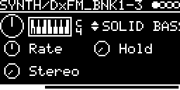

# SYNTH/DxFM

A Yamaha DX7 voice (six operators, 32 algorithms, envelopes, LFO) that plays DX7 32-voice SysEx banks. Built on
msfa, the DX7 engine from Google's Music Synthesizer for Android, as used in Dexed. On Trig and V/OCT two voices
alternate, so the release of one note rings on under the next, optionally spread across the stereo field. Over MIDI
it plays eight voices polyphonically (see [MIDI](#midi)).

## Engines

| Engine | |
|---|---|
| SYNTH/DxFM | the 32 voices of a bank you upload (flash blob `DXFMSYX0`) |
| SYNTH/DxFM_BNK1-3 | the 96 voices of the three FM banks built into Plaits, no upload needed |

## Parameters

| Knob | Range | Default | |
|---|---|---|---|
| **V_OCT** | -4 ... +4 octaves | 0 (C4) | pitch, 0 plays MIDI 60; transposes the MIDI notes too |
| *voice name* | 0 ... 31 (DxFM), 0 ... 95 (BNK1-3) | 0 | the program; the label shows the voice name |
| **Rate** | 0 ... 127 | 64 (middle) | scales envelope rates 2-4: left shorter (x1.5), right longer (x0.5). Left of the middle it also lowers velocity, down to 64 |
| **Hold** | 0 ... 1 s | 0 | keeps the key down this long after the gate falls (or the MIDI Note Off) |
| **Stereo** | 0 ... 1 | 0 | 0: all voices in both channels, 1: every other voice left, the others right |

Left encoder: V_OCT, Rate, Stereo. Right encoder: voice, Hold.

Rate takes effect at the next note. A Trig plays velocity 127 (or what Rate leaves of it); there is no accent
input.

## MIDI

With a MIDI channel on the track (or the MIDI out of another track, `$1MIDI`..`$4MIDI` on its I/O page) DxFM is a
MIDI engine: the notes
play eight voices of their own, next to the two Trig/CV voices. Trig and V/OCT keep working as before.

- Velocity as sent, scaled by Rate like a Trig's velocity (left of the middle down to half).
- The pitch is the key plus the V_OCT knob plus pitch bend (+-12 semitones, like the firmware's bend on V/OCT). The
  V/OCT input, the quantizer and TRANSPOSE/FINE of the I/O page act on the Trig/CV voices only.
- More than eight keys: the new one takes the voice released longest ago, else the one held longest. A key played
  again retriggers its own voice.
- CC 64 sustain pedal; CC 120/123 (All Sound/Notes Off) and MIDI Stop release all keys.
- The firmware also makes a Trig of each note on the track's MIDI channel; DxFM skips it, so a note does not also
  start a Trig/CV voice. A Trig at the input in the same 0.5 ms frame as a Note On is lost with it.
- Two DxFM tracks on the same channel both play every note (before, the firmware shared the notes out to them as
  voices).
- While MIDI voices sound, eight squares at the bottom right show them: filled = key held, open = release.
- A chord sums its notes: eight notes are 4-7x the level of one (single notes of the 96 built-in voices peak at
  0.84, eight-note chords at velocity 127 at up to 2.6). Above 0.85 the output is rounded off softly and reaches
  1.0 at 1.3: single notes stay as they are, loud chords saturate a little instead of clipping hard. The track
  level comes after it: lower that if a track output or the sum still clips.

## Notes

- SYNTH/DxFM needs a bank in flash: the blob `DXFMSYX0`, 32 packed voices (4096 bytes, a 32-voice bulk dump
  without its SysEx header). Make it with the web app's DXFM dialog ("DXFM" on the Module page, or SYNTH/DxFM in the
  emulator): it plays the bank in the emulator, [Load .syx] takes .syx files with DX7 32-voice bulk dumps or single
  voices (several at once, at most 32 voices; fewer are filled up with INIT VOICE), the table renames,
  moves and removes voices, and [Flash to module] writes the bank to the module.
- Without the blob it plays its built-in voice MARIMBA as program 0 and shows "NO DXFM.SYX FOUND!".
- A voice with any byte >= 0x80 is not loaded: it shows "INVALID" and the previous voice keeps playing.
- The voices follow V/OCT changes while they sound (via msfa's master tune). The patch's TRANSPOSE is not applied.
- Changing the program releases all voices.

msfa renders 64-sample blocks at 48 kHz, one per voice; the engine reads 24 samples a frame. The voices' read
positions are staggered, so eight sounding voices render three blocks in every frame. A released voice is no longer
computed once it is below -96 dB. In QEMU (600 MHz): a Trig every 250 ms 1.7-2.5 % CPU (3.7 % in the worst frame,
before 6.4 %), MIDI chords of eight notes 8-10 % (12-15 %).

Code 53 KB, RAM 11.6 KB.

## License and credits

- `DxFM.cpp`: © 2023 E.Heidt, Apache License 2.0 (see the header of the file).
- FM synthesis engine of [music-synthesizer-for-android](https://github.com/google/music-synthesizer-for-android) (Google Inc.) as in Dexed (Pascal Gauthier, Jean Pierre Cimalando), Apache License 2.0.
- [lib/plaits](../../../lib/plaits): Mutable Instruments Plaits, © Emilie Gillet, MIT license.
