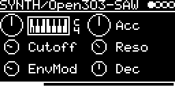

# SYNTH/Open303

A TB-303 bass line voice based on Robin Schmidt's Open303 ([lib/open303](../../../lib/open303), from
sourceforge.net/projects/open303).

## Engines

| Engine | |
|---|---|
| SYNTH/Open303-SAW | saw wave |
| SYNTH/Open303-SQR | square wave (the former SYNTH/Open303: its patches load this one) |

## Parameters

| Knob | Range | Default | |
|---|---|---|---|
| **V_OCT** | -4 ... +4 octaves | 0 (MIDI 36) | pitch, 0 plays the 303's C (65.4 Hz) |
| **Acc** | 1 ... 100 % | 50 % | how much an accented note lifts cutoff and level |
| **Cutoff** | 314 Hz ... 2.4 kHz | 522 Hz | filter cutoff |
| **Reso** | 1 ... 100 % | 34 % | resonance, self-oscillates at 100 % |
| **EnvMod** | 1 ... 100 % | 26 % | filter envelope depth |
| **Dec** | 200 ms ... 2 s | 632 ms | filter envelope decay (normal and accented notes) |

Left encoder: V_OCT, Cutoff, EnvMod. Right encoder: Acc, Reso, Dec.

A trigger starts a note, the gate holds it. The accent input accents the note if high at the trigger (from MIDI:
velocity above 100). Moving the CV while the gate is high glides to the new pitch (about 60 ms slide time).

## How it works

Open303's oscillator plays a band-limited 303 saw or square from a mip-mapped wavetable (built at load; the square
at half the level, as Open303 mixes the two), into the
TeeBeeFilter in TB_303 mode, then the 303's coupling filters and the amp. Everything runs at 48 kHz without
oversampling; the library's anti-aliasing filter is commented out. The amp holds while the gate is high and releases
in 1 ms (50 ms on accented notes).

The screensaver is an acid smiley with rings.

Most of the RAM is the mip-mapped wavetable (98.5 KB).

Code 17 KB, RAM 100 KB.

## License and credits

- `Open303.cpp`: © 2022 E.Heidt, MIT license (see [License](../../../README.md#license)).
- Open303 by Robin Schmidt (rs-met.com), MIT license.
