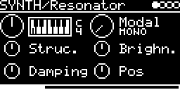

# SYNTH/Resonator

Mutable Instruments Rings: modal resonator, sympathetic strings, a modelled string and a small FM voice, each with
one, two or four voices. A trigger strikes it with Rings' internal exciter. Audio from the I/O page (another track
or an input jack) excites it too, so it also works as a resonator for other sounds.

## Parameters

| Knob | Range | Default | |
|---|---|---|---|
| **V_OCT** | -4 ... +4 octaves | 0 (MIDI 36) | pitch |
| **Model** | 15 entries, see below | Modal mono | model and polyphony |
| **Struc.** | 0 ... 1 | 0.5 | STRUCTURE, depends on the model |
| **Brighn.** | 0 ... 1 | 0.5 | BRIGHTNESS |
| **Damping** | 0 ... 1 | 0.5 | DAMPING, the decay time |
| **Pos** | 0 ... 1 | 0.5 | POSITION, where the resonator is excited |

Left encoder: V_OCT, Struc., Damping. Right encoder: Model, Brighn., Pos.

### Models

Five models, each as mono, duo and quadro (1, 2 or 4 voices), mono ones first.

| Model | | Struc. | Pos |
|---|---|---|---|
| Modal | modal resonator, 60 modes (mono), 28 (duo), 12 (quadro) | spacing of the modes (inharmonicity) | excitation point |
| Sympath. | sympathetic strings, 8 (mono), 4 (duo), 2 (quadro) | tuning of the other strings | excitation point |
| String | one string with dispersion | dispersion, none around 0.25 | excitation point |
| FM | two-operator FM voice | frequency ratio (quantized) | feedback |
| StrQuant. | sympathetic strings tuned to a chord | no effect | excitation point |

## Inputs and outputs

- Trig: strikes the resonator. Triggers within 10 ms of the last one are ignored.
- Audio input (left channel only): set AUX-INPUT (jack or `USB`, level with INSERT-AUX) or INSERT-&lt;engine&gt; on
  the I/O page. It continuously excites the voice that was struck last.
- Stereo out. With one voice: Rings' ODD and EVEN outputs (for Modal the odd and even modes). With more voices they
  alternate between left and right.

Each trigger moves to the next voice; the previous one keeps its pitch and rings out.

## Notes

- The tonic is fixed at 0.2, so the resonator sounds 0.2 semitones above the V/OCT pitch.
- StrQuant. always uses Rings' first chord (OCT): note, an octave below and (mono/duo) an octave above, slightly
  detuned. Struc. does not change it.
- Runs at Rings' own rate and block size (48 kHz, 24 samples), output through Rings' limiter.
- Most of the RAM is the eight strings' delay lines (98 KB).

Code 45 KB, RAM 111 KB.

## License and credits

- `Resonator.cpp`: © E.Heidt, MIT license (see [License](../../../README.md#license)).
- [lib/rings](../../../lib/rings): Mutable Instruments Rings, © Emilie Gillet, MIT license.
