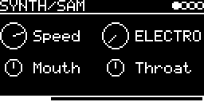

# SYNTH/SAM

SAM, the "Software Automatic Mouth", as a trigger voice. Each trigger says one of six words or a random digit in
SAM's 8-bit voice. Until 2026-10 it was SPEECH/SAM; patches saved with that name load SYNTH/SAM.

## Parameters

| Knob | Range | Default | |
|---|---|---|---|
| Speed | 0 ... 1 | 0.75 | speaking speed, the default is about SAM's normal speed |
| Words | ELECTRO, TECHNO, MODULAR, SYNTHESIZER, OSCILLATOR, EURORACK, RND_0-9 | ELECTRO | RND_0-9 says a random digit |
| Mouth | 0 ... 1 | 0.5 | first formant of the voiced sounds |
| Throat | 0 ... 1 | 0.5 | second formant |

Left encoder: Speed, Mouth. Right encoder: Words, Throat. Knob changes are heard from the next trigger on.

## Inputs and outputs

- TRIG-INPUT: says the word, a new trigger restarts it. MIDI notes trigger it too.
- No V/OCT input, the pitch is fixed.
- Mono audio output.

## How it works

SAM from https://github.com/s-macke/SAM, as the streaming renderer [lib/sam_voice](../../../lib/sam_voice/README.md):
same output as SAM's own code ([lib/SAM](../../../lib/SAM)), but rendered while the word plays instead of all at
once, which keeps the RAM small. The phonemes of the words are SAM's English reciter's, made once on the host and kept
in the app. SAM's 22050 Hz output is interpolated to 48 kHz.

Code 11 KB, RAM 3.3 KB.

## License and credits

- `SAM.cpp`: © 2022 E.Heidt, MIT license (see [License](../../../README.md#license)).
- `../../../lib/sam_voice`: a streaming renderer for SAM by E.Heidt.
- Based on [SAM](https://github.com/s-macke/SAM) by Sebastian Macke, a reverse-engineered version of the Software Automatic Mouth of "Don't ask Software"; abandonware without a license, see [lib/SAM/README.md](../../../lib/SAM/README.md).
