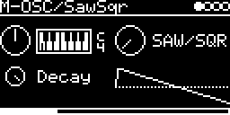

# SYNTH/SawSqr

A simple oscillator that fades from sawtooth to square. Small and cheap, good for bass lines, leads or as a test
tone. On the module it is the engine `M-OSC/SawSqr`.

## Parameters

| Knob | Range | Default | |
|---|---|---|---|
| **V_OCT** | -4 ... +4 octaves | 0 | pitch, in semitone steps |
| **SAW/SQR** | saw ... square | saw | crossfade between the two |
| **Decay** / **Level** | 0 ... 1 | 1 | Decay (4 ms ... 1 s) when a trigger is patched, otherwise Level |

Left encoder: V_OCT, Decay. Right encoder: SAW/SQR. The screen shows one cycle of the current waveform.

## Usage

- With a trigger patched, each trigger restarts the decay envelope. Without one the oscillator plays all the time
  at the set Level.
- V/OCT-INPUT with QUANTIZER and TRANSPOSE sets the pitch. Knob at 0 and 0 V is MIDI note 36.
- MIDI notes trigger it and set the pitch.
- Mono output.

## How it works

Two band-limited (polyBLEP) oscillators from Plaits
([lib/plaits/dsp/oscillator/oscillator.h](../../../lib/plaits/dsp/oscillator/oscillator.h)), a saw and a square,
run side by side and are mixed linearly. The envelope is Plaits' exponential `DecayEnvelope`
([lib/plaits/dsp/envelope.h](../../../lib/plaits/dsp/envelope.h)).

Code 5.1 KB, RAM 184 bytes.

## License and credits

- `SawSqr.cpp`: © 2021 E.Heidt, MIT license (see [License](../../../README.md#license)).
- [lib/plaits](../../../lib/plaits): Mutable Instruments Plaits, © Emilie Gillet, MIT license.
