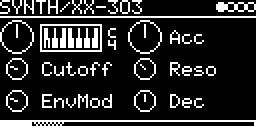

# SYNTH/XX-303

A TB-303 bass line voice based on Robin Schmidt's Open303 ([lib/open303](../../../lib/open303), from
sourceforge.net/projects/open303), with characters: its knob curves, envelopes, accent, amp and pulse wave come from
a character, chosen with **Character**: Open303's own voicing (the default), the TB-03's, fitted to recordings of
the TB-03, ReBirth's, fitted to recordings of ReBirth RB-338's 303, the analog TB-303's, from its circuit (what that
leaves open fitted to the recordings of the TB-03), or AudioRealism ABL3's, fitted to recordings of the ABL3 plug-in.
It contains no code of the TB-03, of ReBirth nor of the ABL3; they were only measured. The characters were fitted with
Claude Opus 5.5 ([how](#how-the-characters-were-fitted)).

SYNTH/Open303 until 2026-10: patches of the release with SYNTH/Open303 load SYNTH/XX-303 with their V_OCT (0 V with
V_OCT at C4 was MIDI 60 there as here), Open303's character and SQR; an accent now comes from the Accent input only
(there with every note while Acc was above 0). Patches of FILTER/TeeBee (the release's 303 filter for another signal) load it with
Wave AUX, their Cutoff, Res, EnvMode, Decay and Accent; unlike TeeBee the voice has its VCA, silent until a note
(`ENGINE_ALIAS` and `engine::restore()` in `XX-303.cpp`). Those of SYNTH/Open303-SAW and -SQR (an engine per wave in
between) don't load.

## Parameters

| Knob | Range | Default | |
|---|---|---|---|
| **V_OCT** | -4 ... +4 octaves | -2 (C2) | pitch at 0 V, C2 the 303's C (65.4 Hz) |
| **Acc** | 0 ... 1 | 0.5 | how much an accented note lifts cutoff and level |
| **Cutoff** | 0 ... 1 | 0.25 | filter cutoff (Character Open303: 314 Hz ... 2.4 kHz, 522 Hz at 0.25) |
| **Reso** | 0 ... 1 | 0.33 | resonance, self-oscillates at 1 |
| **EnvMod** | 0 ... 1 | 0.25 | filter envelope depth |
| **Dec** | 0 ... 1 | 0.5 | filter envelope decay (Character Open303: 200 ms ... 2 s; accented notes as the character has them) |
| **Wave** | SAW, SQR, AUX | SQR | saw or pulse (TB03: its width follows the pitch), or AUX: the AUX-INPUT in place of the oscillator ([below](#aux)); at once |
| **Character** | Open303, TB03, RB303, TB303, ABL3 | Open303 | the character; a change takes effect with the next note. With TB03 it sounds like the TB-03 at the same knob positions, with RB303 like ReBirth's 303, with ABL3 like AudioRealism's ABL3 |
| **Drive** | 0 ... 1 | 0 (off) | a diode distortion, with any Character |
| **Type** | DIODE, TANH, HARD, ASINH, FOLD | DIODE | the drive's curve: DIODE asymmetric (the Drive before), TANH soft, HARD clipped, ASINH compressing, FOLD a wavefolder; patches from before get DIODE |

Two pages, the button R steps from the first to the second (and on to the next track), L back:

- page 1, the 303's knobs: left encoder V_OCT, Cutoff, EnvMod; right encoder Acc, Reso, Dec
- page 2 ([screenshot](XX-303_page2.png)): left encoder Wave, Drive; right encoder Character, Type

The channel bar shows the page in the track's segment (the page shown filled, the other dotted). A firmware without
pages shows all ten on one page (the right column as a list under the Acc knob).

## Usage

A trigger starts a note, the gate holds it. A trigger while the gate is still high (overlapping MIDI notes) slides to
the new note with Character TB03, RB303, TB303 and ABL3 (with Open303 it starts anew), and a CV change while the gate
is high slides with all of them (Open303: about 60 ms). The accent input accents the note if high at the trigger (from MIDI:
velocity above 100).

With **Wave AUX** the voice takes the AUX input in place of its oscillator: the 303 as a filter and VCA
for another signal, played by the notes. It goes through the 303's highpass, filter and amp with the envelopes, the
accent and the Drive as the oscillator would, so a note opens the amp and sweeps the filter; V/OCT changes nothing (the
cutoff doesn't follow the pitch), and before the first note it is silent. The input is set on the I/O page: AUX-INPUT
(the source, (L + R) / 2 of a stereo one) with its AUX-LEVEL, and the feed-in levels of the other tracks (`#2 ...`)
send their audio in. A signal of ±5 V (1.0) is as loud as the saw.

## How it works

- [lib/open303](../../../lib/open303): Open303 whose control takes its constants from a character. Open303's
  oscillator plays a band-limited 303 saw from a mip-mapped wavetable (built at load); the pulse is made from two
  reads of it. Into the TeeBeeFilter in TB_303 mode, then the 303's one-pole highpasses, allpass and notch and the
  amp. Everything runs at 48 kHz without oversampling. The knobs, the envelopes, the accent, the amp and the pulse are
  the character's. With Wave AUX the input's sample takes the oscillator's place before the highpass
  (`Open303::getSample(&input)`), and the oscillator stands.
- The characters: `characters/Characters.h` lists them (Open303 is the library's own; a patch keeps the index, new
  ones are appended), `characters/CharacterTB03.h`, `CharacterRB303.h` and `CharacterABL3.h` hold the fitted
  constants, `characters/CharacterTB303.h` the circuit's values (each with the part it comes from) and the fitted ones.
  `drive/Drive.h` is the Drive.
- **Character Open303**: Open303's voicing, from its constants. The square is a pulse made from the saw table (width
  0.469, its edges softened like Open303's tanh square, at half the level as Open303 mixes the two); the amp holds
  while the gate is high and releases in 1 ms (50 ms on accented notes). Against the original Open303 of
  SYNTH/Open303-SAW and -SQR (the square from its tanh table): the saw sounds the same (0.01 dB), the square 0.44 dB
  apart.
- **Character TB03**, fitted to recordings of the TB-03:
  - Filter envelope: 23 ms (Dec 0) to 218 ms (Dec 1) at Cutoff 0, slower at a high cutoff (52 to 500 ms at Cutoff and
    EnvMod 1), 60 ms on accented notes whatever Dec is. It moves the cutoff between octaves and Hz (fast at the top,
    slow near the base). EnvMod lowers the base cutoff, at EnvMod 1 to 200...460 Hz whatever Cutoff is; the sweep's
    top stays.
  - Accent: a quick sweep of the cutoff, and a level of its own (87 ms, gone after about 200 ms)
    that goes on after the gate, as on the TB-03. Consecutive accents don't build up.
  - Amp: 0.7 ms attack, 5 ms release; a held note fades, faster and faster (about 4 dB from 0.3 to 1 s, 17 dB to
    3.5 s).
  - Glide: two 18 ms one-poles (the TB-03's glide starts slowly).
  - SQR: a pulse made from the saw table read twice, its width 0.41 at C1, 0.51 at C2 and 0.56 at C3; the tables up
    to half the Nyquist frequency.
  - Compared with the TB-03 at the same knobs: 2.0 dB mean difference of the 1/6-octave band levels in 10 ms frames
    (6 knob settings x saw/square x acid, long and slide patterns; Character Open303 9.2 dB), the level within 0.2 dB
    (Open303: 8.9 dB louder); at high resonance (8 more settings, Reso 0.85 to 1) 2.2 dB (Open303 9.2 dB), the level
    1 dB low. The app itself, a trigger every 250 ms: 2.2 dB (Open303 9.6 dB). The largest differences: high
    resonance with a full env sweep, a short decay and accents (3 to 3.6 dB), and the first 40 ms of accented notes.
- **Character RB303**, fitted to recordings of ReBirth RB-338's 303 the same way: 2.1 dB against it (test
  set; at high resonance 2.3 dB; Character Open303 8.9 dB), the app itself 1.9 dB. ReBirth's voice has no amp
  envelope (a held note keeps its level), a slower release (about 20 ms), an accent of up to +14 dB that fades over
  300 ms, and a square whose even harmonics grow with their number (-16 dB at the 2nd, -3 dB at the 10th): the pulse
  only comes near it.
- **Character TB303**, the analog Roland TB-303: its structure and times from its circuit (the schematic of its service
  notes, as Kevin Lightner redrew it, and Robin Whittle's measurements: the Devil Fish manual and "Investigating some
  unique aspects of the TB-303's sound"); what the schematic leaves open (the curves of the knobs, the levels and
  depths) fitted to the recordings of the TB-03, Roland's recreation of it, as there are no recordings of a TB-303
  here.
  - From the circuit: the filter envelope (MEG) from 100 % to 10 % in 200 ms (Dec 0) to 2.5 s (Dec 1), as the
    schematic says, on accented notes always 200 ms (the TB-03: about 3 times shorter); the Accent Sweep Circuit; the
    amp's envelope and gate; the glide.
  - Accent: the Accent Sweep Circuit. The Accent knob's share of the MEG goes through a diode and 47k into the second
    section of the Resonance pot (100k), a 1 µF capacitor at its other end, and from the wiper through 100k into the
    filter's control. At Reso 0 the sweep is the MEG itself, a hard bright snap; the higher Reso, the more it comes
    from the capacitor: the filter rises and falls in a curve ("wow"), and when accents follow one another, the
    capacitor still has charge, so each goes higher than the one before (Cutoff 0, EnvMod 0, Reso 1, Acc 1, accented
    16ths at 120 BPM: the cutoff's peak at 490, 606, 627 Hz, then 631 Hz). Its depth from the circuit (EnvMod comes
    in through 220k, the sweep through 100k: 9.9 octaves) and the fit (9.2) agree. The accent also drives the amp,
    as on the TB-303 not gated, at Acc 1 2.5 times the normal level (fitted; the circuit: 22k + 47k against 220k).
  - Amp (VEG): a held note fades from the start and is silent after about 3.3 s (1 µF through 1.5M, the VCA's current
    ends before the capacitor is full; "~3 to 4 seconds"). 3 ms attack. After the gate the note keeps its level for
    8 ms, then falls in about as many ("8 ms of normal volume and 8 ms of linear decay").
  - Glide: one RC of 22 ms (the DAC's 100k into 0.22 µF; "60 ms").
  - Fitted to the TB-03 (as Character TB03, from its constants): the cutoff, resonance and env mod curves, the
    envelope's shape (partly in Hz), the levels, the accent's depth, diode and amp; the pulse is the TB03
    character's.
  - Compared with the TB-03 at the same knobs: 2.7 dB (the test sets of Character TB03, 84 recordings; Character
    TB03 2.1 dB), the level within 0.1 dB; at Acc 0.88, Cutoff 0.68, Reso 1, EnvMod 0.07, Dec 1 2.9 dB (Character TB03
    3.6 dB). The rest is mostly the longer filter envelope: with TB03's (fitted) 2.4 dB.
  - Not modelled: the 4 ms the TB-303 needs to start a note, the load of the Accent pot, the top of the exponential
    converter, tuning drift.
- **Character ABL3**, fitted to recordings of AudioRealism's ABL3 (the ABL3x VST plug-in, audiorealism.se), a TB-303
  in software, in its default emulation:
  - Recorded with a small VST host under Wine that plays the plug-in by MIDI as the app is played by trigger and gate
    (accent: velocity above 100, slide: overlapping notes), at the knob settings and note patterns of the TB-03's
    recordings (719). Its pitch flutter off, its output not clipped, its tuning 3.7 cents lower: the plug-in plays
    3.7 cents sharp at every note, the character doesn't.
  - Single measurements showed a TB-303's structure: a held note fades from its start, the accent's level comes at
    once, accents in a row build up, the glide is one RC of 21 ms. So the fit started from Character TB303 (its Accent
    Sweep Circuit, amp envelope, gate hold and glide) and fitted its constants to the ABL3, all but the glide (22 ms).
  - The filter envelope: 150 ms (Dec 0) to 1.3 s (Dec 1) from 100 % to 10 % (TB303: 200 ms to 2.5 s), 160 ms on
    accented notes. The Accent Sweep Circuit fitted (its depth 9.5 + 1.2 Cutoff octaves, the capacitor 122 ms). The
    pulse: its width 0.51 at C2, wider below and narrower above, its edges softened.
  - Its level that of Character TB303 (the ABL3 at its default volume is about 10 dB louder).
  - Compared with the ABL3 at the same knobs: 2.3 dB (the test set, 36 recordings never fitted; Character TB303 3.7 dB,
    TB03 4.2, RB303 5.1, Open303 8.4), the level within 0.1 dB; at high resonance 2.5 dB (TB303 4.0), the level 0.7 dB
    low. The app itself, a trigger every 250 ms: 2.1 dB (TB303 4.3, TB03 4.8, Open303 8.5).
  - Not in it: the ABL3's other emulation models and options, its drive and distortion, the start phase of its
    oscillator at a note, the square's edges (one steeper than the other: its even harmonics grow with their number).
- **Drive**: a curve after the voice, chosen by Type: a gain (x 1 to x 63, +36 dB; FOLD x 1 to x 16, linear) into
  the curve, a one-pole lowpass (12 kHz to 5 kHz with the knob), the level made up so that a voice's peak stays about
  where it was, and a DC blocker. The bass stays. 2x oversampled (a 39-tap halfband), 0.4 ms later; at 0 it is off and
  costs nothing. The curves (a sine at the voice's peak):
  - DIODE: a diode's `1 - e^-u`, on the negative side one that clips at 0.75 of it: even harmonics too (H2 -27 dB
    at Drive 0.5), a little DC, taken out after. The Drive before.
  - TANH: `tanh(u)`, soft and symmetric: odd harmonics only.
  - HARD: clipped to ±1: clean up to the corner (no harmonics at Drive 0.25), then square; the buzziest.
  - ASINH: `asinh(u)`, unbounded: it compresses rather than clips, about half the harmonics of the others at Drive 1
    (THD 22 % against 40 %), and the notes keep their dynamics; up to 4 dB quieter.
  - FOLD: a sine wavefolder (aanl.lib's with t = 1, r = 1): straight up to ±1, then `sin(pi u / 2)`, folding back
    from Drive 0.2 on, twice at 1: metallic, a harmonic louder than the fundamental (the 3rd at Drive 0.5, the 5th
    at 1).
  DIODE, TANH and HARD differ most at a middle Drive; at 1 all three come close to a square. Each curve is
  antialiased with first-order ADAA, `aanl::ADAA1` of Faust's aanl.lib ([lib/aanl](../../../lib/aanl/README.md)):
  the difference quotient of its antiderivative instead of the curve (DIODE: 14 to 23 dB less aliasing than without,
  1 to 8 kHz), 0.5 dB less at 10 kHz. A new Type fades in over 5 ms beside the old one, so the switch doesn't click.
- CPU, instructions a frame: Open303 10.4k (SAW) and 11.1k (SQR), TB03 and RB303 10.9k and 11.6k, TB303
  11.2k and 11.8k, ABL3 11.2k and 11.9k, with AUX 9.1k (Open303) to 9.9k (no oscillator); with Drive 6.5k (HARD)
  to 13.4k (TANH) more. The choice of the AUX input per sample costs 0.3k (an engine body per wave would take 2 KB of flash).

The screensaver is an acid smiley with rings.

Code 18 KB, RAM 100 KB (most of it the mip-mapped wavetable, 98.5 KB). Building it at load takes another 52 KB of
heap for the while (the prototype table, the FFT and its spectrum), little stack: on the stack the prototype and the
spectrum took 21 KB of the DSM's 22.5 KB.

The binary takes 6 flash sectors since Character ABL3 (22396 bytes, a character is 400): on a module that has the
5-sector version (at most 20447 bytes) app/upload.py can't write it in place, the web app's [Update all] (or a firmware
image with the apps) writes the chain of apps again. lib/open303's BiquadFilter and OnePoleFilter have only the modes
the voice uses, and the coefficient functions and the Drive's 96 kHz step and curve are not inlined.

## How the characters were fitted

The fitting was done with Claude Opus 5.5 (Anthropic), working as a coding agent in this repository: it wrote the
model, the measure and the fit, ran them and chose each next step from the results.

1. **Recordings.** The voice to match, played at set knob positions and note patterns: 24 random knob settings and 6
   extreme ones (high resonance and env mod), each with an acid pattern (16ths at 120 BPM with accents, slides and
   rests), long notes at C1, C2 and C3 and notes held for 4 s, saw and square; single measurements (the static filter
   response of long saw notes, the filter over a note, the level after the gate, the accent's level over time, the
   glide's pitch, the pulse's harmonics); held notes over a grid of cutoff x resonance x env mod. About 700 recordings
   of the TB-03, the same sets of ReBirth's 303 and of the ABL3 (its VST plug-in under Wine in a small VST host,
   played by MIDI). Only their audio was used, as from a recorder.
2. **Model.** Open303's voice with every constant of its control taken from a character: the knob curves as
   polynomials, the envelopes, the accent, the amp, the glide, the pulse. The single measurements chose its structure,
   e.g. the TeeBeeFilter in its TB_303 mode (it fits the TB-03's static filter responses best, 0.2 to 1 dB), an accent
   level that is not gated, an envelope that moves the cutoff partly in Hz, an env mod that lowers the base cutoff.
3. **Measure.** 1/6-octave band levels (40 Hz to 12 kHz) in 10 ms frames, floored 60 dB below the top: the model
   rendered with each recording's knobs and pattern, its levels against the recording's, frame by frame.
4. **Fit.** Least squares (soft L1) on those differences plus each render's level, in stages: level, filter and
   envelope, accent and amp, then everything, the pulse on the square recordings. Each new piece of structure was
   followed by a refit; where the tests stayed off (high resonance), the held-note grid gave the env mod's terms of
   the base cutoff and resonance directly, then came more recordings there and another refit. The TB-03: 87
   constants. ReBirth's 303 the same way, from the TB-03's constants as a start; the ABL3 from Character TB303's
   constants (it has a TB-303's structure), the held notes fitted together with the patterns.
5. **Test.** Against recordings that were never fitted (6 knob settings x saw/square x 3 patterns, and 8 settings at
   high resonance): the numbers above (TB03 2.0 dB, RB303 2.1 dB, ABL3 2.3 dB; Open303's own voicing about 9 dB).

The character TB303 is fitted only in part: its times, the amp's envelope and gate, the glide and the Accent Sweep
Circuit come from the TB-303's schematic and Robin Whittle's measurements and were held; what the schematic leaves open
(the knob curves, the levels and depths, the accent's depth) was fitted the same way to the recordings of the TB-03.

## License and credits

- `XX-303.cpp`: © 2022 E.Heidt, MIT license (see [License](../../../README.md#license)).
- Open303 by Robin Schmidt (rs-met.com), MIT license; [lib/open303](../../../lib/open303) is a changed copy (its
  changes, MIT license as well). The characters: MIT license as well.
- The TB-03, ReBirth and the ABL3 were measured, not copied: no code of them is in this app.
