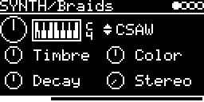

# SYNTH/braids

The macro oscillator of Mutable Instruments Braids: 48 models (analog, digital, vocal, FM, physical models,
percussion, wavetables, noise) plus the 10 chord and stack models of Braids Renaissance. It has an AD envelope as
VCA and an optional detuned second oscillator on the right channel. On the module it is the engine `SYNTH/Braids`
(`M-OSC/Waveforms` until 2026-10-26; patches with that name load it, with V_OCT 2 octaves down: the firmware played
V_OCT 2 octaves lower until 2026-10, so they sound as they did).

## Parameters

| Knob | Range | Default | |
|---|---|---|---|
| **V_OCT** | -4 ... +4 octaves | 0 | pitch, in semitone steps |
| **Shape** | 58 models, see below | CSAW | |
| **Timbre** | 0 ... 127 | 64 | first model parameter |
| **Color** | 0 ... 127 | 64 | second model parameter; picks the chord on chord shapes, see below |
| **Decay** / **Level** | 0 ... 127 | 64 | with a trigger patched: envelope decay, 1.5 ms ... 12 s. Fully right = VCA-off (no envelope). Without a trigger it is Level |
| **Stereo** | 0 ... 127 | 0 | detunes the right oscillator up to 2 semitones; 0 = both the same |

Left encoder: V_OCT, Timbre, Decay. Right encoder: Shape, Color, Stereo. What Timbre and Color do per model is
listed in [lib/braids/README.md](../../../lib/braids/README.md).

### Shapes

In the order of the Shape knob:

| Group | Shapes |
|---|---|
| Analog waveforms | `CSAW` `/\-_` `//-_` `FOLD` |
| Digital synthesis | `UUUU` `SUB-` `SUB/` `SYN-` `SYN/` `//x3` `-_x3` `/\x3` `SIx3` `RING` `////` `//UU` `TOY*` `ZLPF` `ZPKF` `ZBPF` `ZHPF` `VOSM` |
| Vocal | `VOWL` `VFOF` |
| Additive, FM | `HARM` `FM` `FBFM` `WTFM` |
| Physical models | `PLUK` `BOWD` `BLOW` `FLUT` |
| Percussion | `BELL` `DRUM` `KICK` `CYMB` `SNAR` |
| Wavetables | `WTBL` `WMAP` `WLIN` `WTx4` |
| Noise | `NOIS` `TWNQ` `CLKN` `CLOU` `PRTC` `QPSK` |
| Easter egg | `****` |
| Chords (Renaissance) | `//CH` `-_CH` `/\CH` `SICH` `WTCH`: saw, square, triangle, sine, wavetable |
| Stacks (Renaissance) | `//x6` `-_x6` `/\x6` `SIx6` `WTx6`: the same five waveforms |

### Chords and stacks

On the chord shapes (`//CH` ... `WTCH`) the QUANTIZER on the I/O page decides which chords Color selects:

| QUANTIZER | Color | Chords |
|---|---|---|
| OFF | 0 ... 127 | the Renaissance table of 4-note chords (unisons, fifths, minor, major, ...), with a short glide between them |
| SEMI | OCT, Fifth, min, min7, min9, min11, Maj, Maj7, Maj9, Sus4, 69, 6th, 10th, D7, D7(b9), HD, FD | Plaits' chord table, quantized to semitones |
| any other scale | Chord-1 ... Chord-8 (1+3+5+8, 1+3+5+6+8, 1+3+5+7, 1+3+5+6+7, 1+3+5+7+9, 1+3+5+7+9+11, 1+3+5+6+8+11, 1+3+5+9) | diatonic chords in the chosen scale, built on the played note |

On the stack shapes (`//x6` ... `WTx6`) Color stays a knob. With a quantizer they play five notes, each 1 ... 16
scale degrees above the previous; without one they play the same chords as the chord shapes.

Timbre on both: the second set of detuned saws (saw), pulse width (square), wavefolder (triangle, sine) or wave
position (wavetable).

## Usage

- TRIG-INPUT starts the envelope and strikes the model, which matters for the percussive and physical models
  (`PLUK`, `BELL`, `KICK`, ...).
- V/OCT-INPUT with QUANTIZER and TRANSPOSE. Knob at 0 and 0 V is MIDI note 60.
- MIDI notes trigger it and set the pitch.
- Stereo output: left is the main oscillator, right the detuned one (same as left at Stereo 0).

## Notes

- Color keeps its value when its meaning changes, so after switching away from a chord shape with a quantizer
  (range 0 ... 16 or 0 ... 7) it sits near 0.
- In SEMI mode some chords are off by one from Color 12 on (10th plays D7, D7 plays D7(b9), and so on, HD and FD
  both play FD). The intervals are rounded to whole semitones, so e.g. Sus4 sounds 0, 6, 7, and octave doublings
  collapse onto the root.
- The sine and wavetable chords play at most five notes, so the 11th chords lose their top note there.
- The right oscillator follows a Shape change up to 6 ms later than the left.

## How it works

Braids' `MacroOscillator` ([lib/braids/macro_oscillator.cc](../../../lib/braids/macro_oscillator.cc)) renders
16-bit samples in blocks of 24. The chord and stack models are boourns' Braids Renaissance code
([lib/braids/chords_stack.cc](../../../lib/braids/chords_stack.cc)), the SEMI chords come from Plaits
([lib/plaits/dsp/chords/chord_bank.cc](../../../lib/plaits/dsp/chords/chord_bank.cc)). The quantizer is the
firmware's, not Braids' own. Braids' pitch tables are made for 96 kHz and are shifted an octave to fit 48 kHz. VCO
drift, flattening and AD->FM are off.

Code 117 KB, RAM 37 KB.

## License and credits

- `braids.cpp`: © 2021 E.Heidt, MIT license (see [License](../../../README.md#license)).
- [lib/braids](../../../lib/braids): Mutable Instruments Braids, © Emilie Gillet, MIT license.
- [lib/plaits](../../../lib/plaits): Mutable Instruments Plaits, © Emilie Gillet, MIT license.
