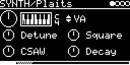
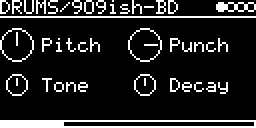

# SYNTH/plaits



Mutable Instruments Plaits ([lib/plaits](../../../lib/plaits)) in one binary. **SYNTH/Plaits** has its models in one
engine, picked by the **Model** knob as on Plaits: the oscillators, the speech engine and the physical models of the
original Plaits (its green and red banks) and those Plaits 1.2 added (the orange bank). The model Speech took over
SPEECH/LPC (see [Speech](#speech)). The six drums of the red bank are engines of their own. More is in the source,
not built by default: the two noise models (Noise and Particle; see [Models](#models)) and 6-OP FM (SYNTH/DxFM_BNK1-3
plays its patches; see [SYNTH/6-OP-FM](#synth6-op-fm)). A switch at the top of `plaits.cpp` builds each:
`PLAITS_NOISE`, `PLAITS_SIX_OP` 0 or 1 (or `-DPLAITS_SIX_OP=1` in a `// build_flags:` line), `PLAITS_SPEECH` 0
leaves out the model Speech.
`app/build.sh` and `sync_readme.sh` take the engine names as the compiler sees them, so the name comes and goes with
it.
SYNTH/Plaits is polyphonic over MIDI: four voices, each with its own Plaits engine, LPG and decay envelope (see
[MIDI](#midi)); on Trig and V/OCT one voice plays. The drums are one voice.

## Engines

| Engine | |
|---|---|
| SYNTH/Plaits | Plaits' 16 models (18 with `PLAITS_NOISE` 1), see [Models](#models) |
| DRUMS/Analog BD | analog bass drum with overdrive |
| DRUMS/909ish-BD | synthetic bass drum |
| DRUMS/Analog SD | analog snare |
| DRUMS/909ish-SD | synthetic snare |
| DRUMS/Analog HH | hi-hat: six square oscillators, resonant band-pass |
| DRUMS/Analog HH2 | hi-hat: three ring-modulated square pairs |
| SYNTH/6-OP-FM | six-operator FM (DX7) with the 96 patches of Plaits' three banks; only with `PLAITS_SIX_OP` 1 |




The screenshots show SYNTH/Plaits (its two pages) and DRUMS/909ish-BD.

Patches of the release (2026-04) with M-OSC/Virt.Analog, Waveshaping, 2-OP-FM, Grain, Harmonic, Wavetable, Chord,
SYNTH/ClassicVAVCF, MIDI/VAx6 and SPEECH/LPC load SYNTH/Plaits with their model and values (SPEECH/LPC the model
Speech with its word, see [Speech](#speech)), sounding as before (`ENGINE_ALIAS` and `engine::restore()` in
`plaits.cpp`; V_OCT 2 octaves down for the engines, which the firmware played 2 octaves lower until 2026-10); the
modulations move with their parameters. Patches of SYNTH/Plaits (M-OSC/Plaits) from before load as they are; saved
before the model Speech came (2026-10-28), one with Swarm or a model after it plays the model before it (Swarm ->
Speech, String -> Swarm, ...).

## SYNTH/Plaits

### Models

| Model | | before 2026-10-26 |
|---|---|---|
| VA | detuned variable square and variable saw | M-OSC/Virt.Analog |
| Shaping | slope oscillator into waveshaper and wavefolder | M-OSC/Waveshaping |
| 2-OP-FM | two-operator FM with feedback | M-OSC/2-OP-FM |
| Grain | granular formant oscillator, crossfades into the Z oscillator (AUX) | M-OSC/Grain |
| Harmonic | additive, 24 harmonics, crossfades into 8 organ harmonics (AUX) | M-OSC/Harmonic |
| Wavetbl | four 8 x 8 wavetable banks, crossfades into a 5-bit version (AUX) | M-OSC/Wavetable |
| Chord | chords from divide-down string-synth oscillators or wavetable waves | M-OSC/Chord |
| Speech | vowels of a formant filter, SAM and LPC, LPC phonemes, the 92 LPC words; only with `PLAITS_SPEECH` 1 (the default) | SPEECH/LPC (the words), SYNTH/Speech (2026-10-28) |
| Swarm | eight sawtooth (AUX: sine) grains, randomly detuned, from a cloud to a swarm of glissandi | M-OSC/Swarm |
| Noise | clocked noise through a resonant LP/BP/HP filter (AUX: two band-passes); only with `PLAITS_NOISE` 1 | NOISE/Filtered |
| Particle | random impulses into resonant band-passes or an all-pass diffuser (AUX: the raw impulses); only with `PLAITS_NOISE` 1 | NOISE/Particle |
| String | inharmonic string (Karplus-Strong with dispersion), struck by a noise burst | SYNTH/String |
| Modal | modal resonator (24 modes), struck by a mallet or noise burst | SYNTH/Modal |
| VA-VCF | VA oscillator with sub into a resonant 2- or 4-pole low-pass | SYNTH/ClassicVAVCF |
| PhaseDst | phase distortion, a synced (AUX: free-running) modulator | M-OSC/PhaseDist |
| Terrain | a 2D terrain read along an elliptic path (AUX: path and terrain through a sine) | M-OSC/WaveTerrain |
| Str.Mach | string machine: a chord of divide-down oscillators, filter and ensemble | SYNTH/Str.Machine |
| Chiptune | square-wave chords and arpeggios with a NES triangle bass (AUX) | M-OSC/Chiptune |

Each model was an engine of its own until 2026-10-26 (the last column; Speech until 2026-10-28). A model sounds as
that engine did with the same knobs (QEMU: the same output for Trig/CV, drone and MIDI notes, apart from the last bit
of the knob smoothing). Patches of those engines do not load any more, except those of the release (above) and of
SYNTH/Speech.

The noise models are not built by default (`PLAITS_NOISE` 0): 5 KB less code, and SYNTH/Plaits keeps 46 KB a track
instead of 91 KB (Particle's diffuser takes 16 KB a voice, see [Notes](#notes)). Without them the models after Swarm
are two places further up on the Model knob.

### Knobs

Page 1: **V_OCT**, **Model**; HARMONICS, TIMBRE (named after what they do in the model); MORPH, **Decay**. Page 2
(button R) lies under page 1, each knob where the one it acts on is: **F-Env** (Fine) under V_OCT, **AuxMix** (the
model's outputs) under Model; **Stereo**, **T-Env** under TIMBRE; **M-Env** under MORPH, **Color** under Decay (the
LPG).

```
page 1             page 2
V_OCT  | Model     F-Env  | AuxMix
HARMON.| TIMBRE    Stereo | T-Env
MORPH  | Decay     M-Env  | Color
```

| Knob | Range | Default | |
|---|---|---|---|
| **V_OCT** | -4 ... +4 octaves | 0 (C4) | pitch of the Trig/CV voice at 0 V; transposes the MIDI notes, 0 plays the key |
| **Model** | the 16 models (18 with `PLAITS_NOISE` 1) | VA | the model, also by modulation (CV, LFO, ...) |
| HARMONICS, TIMBRE, MORPH | 0 ... 1 | 0.5 | the model's three knobs, see below |
| **Decay** | 0 ... 1 | 0.5 | LPG and envelope decay of all voices, after a key or gate is let go. With the Trig input set to `-` (and no MIDI note yet) it becomes **Level** and the engine drones. String and Modal have no LPG: the knob is shown only as Level |
| **Color** | 0 ... 1 | 0.5 | LPG colour: higher is brighter, toward a plain VCA. Not shown on String, Modal (no LPG) and Chiptune (its LPG is a VCA, as before) |
| **AuxMix** | 0 ... 1 | 0 | crossfade from Plaits' OUT to AUX |
| **T-Env** | -1 ... +1 | 0 | how much the decay envelope of a Trig or note moves TIMBRE, up or down (Plaits' TIMBRE attenuverter with nothing at its CV input); the VA-VCF's cutoff envelope. Not on Chiptune (Decay is its envelope) |
| **M-Env** | -1 ... +1 | 0 | the same on MORPH (Plaits' MORPH attenuverter); **Speed** of the words on Speech |
| **F-Env** | -1 ... +1 | 0 | the same on the pitch, the envelope squared, up to ±48 semitones at the start (Plaits' FM attenuverter); **Prosody** of the words on Speech. With the Trig input set to `-` it is **Fine**: ±1 semitone, as Plaits' FM attenuverter without TRIG |
| **Stereo** | 0 ... 1 | 0 | stereo width, as Stereo of SYNTH/Braids: Plaits' ensemble (the chorus of its string machine) on the output, the right channel's taps modulated the other way round, so the two channels drift apart in pitch. At 0 both channels carry the same signal, as before |

Stereo keeps the level of each channel (within ±1.2 dB; a make-up gain for the part of the chorus that cancels the dry
signal); the sum of both, on a mono output, is up to 2 dB lower at 1, the two channels no longer being the same.
SYNTH/Braids computes its oscillator a second time, detuned, for the right channel; here that would double the cost of
five voices, the ensemble costs 4k instructions a frame (1.3 %), only while Stereo is above 0.

The three envelope knobs act on a Trig and on the MIDI notes, not in the drone (Trig input `-`), as on Plaits with
TRIG patched. They are squared a little toward the middle (Plaits' curve: ±1 at the ends, a small dead zone at 0). The
envelope is Plaits' decay envelope, its length set by Decay.

The knobs keep their values when the model changes, as on Plaits; the knobs act on all voices, sounding notes
included. The engines before had their defaults per model; those are in the tables below.

A change of model makes the new model's engine in each voice anew, as Plaits does: a voice that sounds goes on with
its LPG and envelope, the oscillator starts again. The voices go over one a frame (0.5 ms), the sounding ones first,
so all five take 2.5 ms; a voice that a Trig or note starts goes over at once. A change costs up to 20k instructions
in its frame (String and Particle clear up to 32 KB), the other models less.

### VA

| Knob | before | |
|---|---|---|
| **Detune** | 0.5 (unison) | saw against square, -24 ... +24 semitones, with plateaus at 0, 7, 12, 19, 24 |
| **Square** | 0.5 | narrow pulse to square at 0.5, above that hard sync |
| **CSAW** | 0.5 | triangle tilting into a saw, then a saw with a widening notch |

### Shaping

| Knob | before | |
|---|---|---|
| **Curve** | 0.8 | waveshaper curve |
| **Fold** | 0.8 | wavefolder amount |
| **Asym** | 0.75 | slope of the source, triangle at 0 |

### 2-OP-FM

| Knob | before | |
|---|---|---|
| **Ratio** | 0.8 | modulator frequency, -12 ... +36 semitones, with plateaus |
| **Mod** | 0.8 | modulation index |
| **Feedb.** | 0.75 | below 0.5 feedback into frequency, above into phase, none at 0.5 |

### Grain

| Knob | before | |
|---|---|---|
| **Ratio** | 0.8 | OUT: second formant ±24 semitones. AUX: Z oscillator mode |
| **Frm/Fq.** | 0.8 | formant frequency |
| **Width** | 0.75 | carrier shape |

AuxMix was 0.5 (the knob was named PD-Mix): OUT (grainlets) into AUX (Z oscillator).

### Harmonic

| Knob | before | |
|---|---|---|
| **Bump** | 0.8 | number of bumps in the spectrum |
| **Peak** | 0.8 | the most prominent harmonic |
| **Shape** | 0.75 | bump slope, flat and wide at 0, narrow at 1 |

AuxMix was 0.5: OUT (24 harmonics) into AUX (organ harmonics).

### Wavetbl

| Knob | before | |
|---|---|---|
| **Bank** | 0 | HARMONICS 0 ... 0.5 (the knob at 1 is 0.5, as the engine before): up to 0.86 the knob moves through the four banks; above that Row and Column snap more and more to whole waves |
| **Row** | 0.8 | TIMBRE, one axis of the bank |
| **Column** | 0.75 | MORPH, the other axis |

AuxMix was 0.5: OUT into AUX (5-bit). Without user data the fourth bank is a scrambled pick of the built-in waves.
The waves are integrated, the engine differentiates them: a voice that goes over to Wavetbl while it sounds starts
at the knobs' wave, with a block rendered for nothing (else the first sample was a spike of 4 ... 8 times full
scale).

### Chord

| Knob | before | |
|---|---|---|
| **Chord** | Maj9 (0.5) | the chord, 17 steps of the knob: OCT, Fifth, min, min7, min9, min11, Maj, Maj7, Maj9, Sus4, 69, 6th, 10th, D7, D7(b9), HD, FD (Jon Butler's table; shown as the knob's value); every MIDI note plays the whole chord |
| **Inv.** | 0.5 | inversion and transposition |
| **Shape** | 0.5 | below about 0.47 string-synth registrations, above about 0.53 wavetable waves |

### Speech


Plaits' speech engine: vowels of a formant filter, of SAM and of LPC, the LPC phonemes, and the 92 words of its five
LPC word banks (LPC10 from Texas Instruments ROMs). It took over SPEECH/LPC, which had the words alone, and
SYNTH/Speech, the engine of its own it was for a day (2026-10-28). The knobs show what plays: Bank the kind of speech
or the word bank, in a word bank MORPH the word (a word of more than 8 letters with its first 7 and a dot:
"synthes.").

| Knob | before | |
|---|---|---|
| **Bank** | 0.5 | Formant (formant-filter vowels) into SAM's vowels up to 1/6, into LPC's up to 1/3, then Phoneme (LPC phonemes, up to 0.43), then the word banks Colours (from 0.43), Numbers (0.54), Letters (0.64), NATO (0.74), Synth (0.84) |
| **Species** | 0.5 | formant shift ±18 semitones, from a giant to a chipmunk; with the words below 0.4 also slower, above 0.6 faster |
| **Phon.** / **Word** | 0.5 | the vowel or phoneme; in a word bank the word, its name on the knob |
| **Prosody** (F-Env) | 0 | with the Trig patched and on MIDI notes: how much of its recorded intonation a word gets, 0 monotone, below 0 inverted; on the vowels and phonemes the pitch envelope, as F-Env. Without Trig **Fine** |
| **Speed** (M-Env) | 0 | with the Trig patched and on MIDI notes: how fast the words are spoken, 0 as recorded, 1 four times faster, -1 four times slower; on the vowels and phonemes the envelope on MORPH, as M-Env |

| Word bank | Words |
|---|---|
| Colours | red, orange, yellow, green, blue, indigo, violet |
| Numbers | zero ... ten |
| Letters | a ... z |
| NATO | alpha, bravo, charlie, ... zulu |
| Synth | analog, circuit, clock, control, digital, electronic, filter, frequency, generator, instrument, knob, machine, modular, modulator, operator, oscillator, patch, sequencer, synthesizer, vca, voltage, waveform |

A Trig or a MIDI note speaks the word from its start with its own intonation and envelope (no LPG: Decay and Color act
on the vowels and phonemes); in the vowel models it opens the LPG, in the LPC phonemes with a consonant first. Each of
the four MIDI voices speaks its key. With the Trig input set to `-` the voice drones at the Level of the Decay knob, in
a word bank a frame of the bank (at MORPH) looping, as Plaits does.

Plaits' `Load()` decodes all words of a bank, 14 KB a voice, the synth words in one frame (223k instructions, 74 % in
QEMU). Here (`SpeechWordEngine` in `plaits.cpp`) a voice decodes the word it plays as far as it plays it and keeps its
frames, 1 KB a voice in the memory SYNTH/Plaits keeps anyway: the same sound (the Trig/CV voice in QEMU bit-exact with
the engine before), at most 23k instructions in a frame (8 %). CPU in QEMU: the Trig/CV voice 1.2 % (words) ... 3 %
(formant vowels), four MIDI voices 4 % (words) ... 11 % (formant vowels).

Patches of SPEECH/LPC (the release's) load the model Speech with the word bank and the word of their Word, its Speed
(M-Env), Form.Shift (Species), Prosody (F-Env) and AuxMix, V_OCT 2 octaves down (the firmware played it 2 octaves lower
until 2026-10); those of SYNTH/Speech with their knobs. Unlike SPEECH/LPC the right channel is the left one (with
Stereo at 0; SPEECH/LPC had the excitation alone there, AuxMix mixes it in), a word begins 4 ms after its Trig (Plaits'
trigger delay), and it peaks lower at about the same loudness. A modulation of Word is dropped; one of Speed or
Prosody moves them twice as far (their range is -1 ... 1 now). Without Trig, F-Env is the fine tune: SPEECH/LPC's
Prosody 0.5 plays 24 cents sharp there.<br clear="right"/>

### Swarm

| Knob | before | |
|---|---|---|
| **Spread** | 0.5 | how far the eight grains are detuned at random: none at 0, ±6 semitones at 0.5, ±4 octaves at 1 |
| **Density** | 0.5 | how often new grains start |
| **Overlap** | 0.5 | grain length: short grains toward 0; above about 0.71 they glide into each other (a swarm of glissandi) |

AuxMix: OUT (saws) into AUX (sines). A Trig starts a burst of grains that slows down; with the Trig input set to `-`
the grains go on without end.

### Noise

Only with `PLAITS_NOISE` 1.

| Knob | before | |
|---|---|---|
| **Filter** | 0.5 | OUT: low-pass, band-pass at 0.5, high-pass. AUX: the second of two band-passes, -24 ... +24 semitones from the first |
| **Clock** | 0.9 | clock of the noise (sample and hold), about 2 Hz ... 13 kHz (from 8 Hz in the drone); 0.9 is 5.5 kHz |
| **Reson.** | 0.5 | resonance, Q 0.5 ... 512 (16 at 0.5) |

The filters sit at the note (V_OCT, V/OCT, MIDI key). A Trig restarts the noise clock.

### Particle

Only with `PLAITS_NOISE` 1.

| Knob | before | |
|---|---|---|
| **Spread** | 0.5 | each impulse's band-pass is put at random around the note, up to ±48 semitones at 1 (±12 at 0.5) |
| **Density** | 0.65 | impulses: about one a second at 0, 50 at 0.65, 6000 at 1 |
| **Filter** | 0.7 | below 0.5 an all-pass diffuser, more of it toward 0 (a smear like a reverb); above 0.5 the band-passes resonate more and more |

AuxMix: OUT into AUX (the raw impulses). A Trig fires an impulse at once. OUT is 3 times as loud as in Plaits and
without its limiter, which held the spiky impulses 10 dB below the oscillators; the soft limit of the output (see
[MIDI](#midi)) rounds off their peaks.

### String and Modal

| Knob | before | |
|---|---|---|
| **Inharm.** (String) | 0.5 | below 0.24 a curved bridge that buzzes (sitar), up to 0.26 a plain string, above it a stiffer and stiffer, inharmonic string |
| **Struct.** (Modal) | 0.5 | the ratios of the modes: from harmonic to bell-like and inharmonic (the material) |
| **Bright** | 0.5 | brightness of the strike (noise burst or mallet); in the drone also how dense the dust that excites it |
| **Decay** | 0.5 | MORPH: the damping, short at 0, long at 1 |

Both ring by themselves, as in Plaits: no LPG (no Decay knob next to their own, no Color; Level in the drone), no
sustain, the Note Off lets them ring on. A Trig strikes; with the Trig input set to `-` they are excited all the time
by dust. On Trig and V/OCT the string model rings three strings in turn, so a note rings on under the next (Plaits);
each MIDI voice is one string. The string goes into Plaits' limiter with a gain of 5 instead of 1, else it is 14 dB
below the oscillators.

### VA-VCF

| Knob | before | |
|---|---|---|
| **Harsh** | 0.5 | 4-pole on the left, 2-pole on the right, no resonance in the middle, more drive toward 1 |
| **Cutoff** | 0.5 | cutoff, tracks the note: 2 octaves below at 0, up to 8 above (max 12 kHz) |
| **Morph** | 0.5 | saw, square at 0.5, narrowing pulse, back to square. Sub octave fades in at both ends |

The engine before had the knobs in the order Morph, Cutoff, Harsh, EnvMod, Decay. Its EnvMod is T-Env now, the
envelope's depth on the cutoff. Decay works up to 0.99 (the knob above it is 0.99).

### PhaseDst

| Knob | before | |
|---|---|---|
| **Ratio** | 0.5 | frequency of the modulator, as Ratio of 2-OP-FM |
| **Amount** | 0.5 | how far the phase is distorted (less on high notes) |
| **Asym** | 0.5 | asymmetry: pulse width of the distortion, 50 ... 99 % |

AuxMix: OUT (the modulator synced to the note) into AUX (free-running: phase modulation).

### Terrain

| Knob | before | |
|---|---|---|
| **Terrain** | 0.5 | eight terrains, crossfaded: five functions of sines and fractions, then three built from wavetables |
| **Radius** | 0.5 | radius of the path, 0.1 ... 1 (smaller on high notes) |
| **Offset** | 0.5 | where the path lies on the terrain, -1 ... +0.9 |

AuxMix: OUT (the terrain along the path) into AUX (the path's y plus the terrain through a sine).

### Str.Mach

| Knob | before | |
|---|---|---|
| **Chord** | Maj9 (0.5) | chord, as on Chord; every MIDI note plays the whole chord |
| **Filter** | 0.5 | low-pass cutoff, opens toward 1; and the ensemble (chorus): none at 0.5, more toward both ends |
| **Regist.** | 0.5 | registration: eleven mixes of saw and square footages, from saw to square |

AuxMix was 0.5: OUT and AUX are Plaits' stereo pair (left, right), 0.5 is the mono sum.

### Chiptune

| Knob | before | |
|---|---|---|
| **Chord** | Maj9 (0.5) | chord, as on Chord |
| **Arp** / **Inv.** | 0.5 | Trig patched: the arpeggio of the Trig/CV voice, 12 patterns (up, down, up-down, random; each over 1, 2 or 4 octaves). Without Trig and on the MIDI voices the chord's inversion and transposition (**Inv.**) |
| **Shape** | 0.5 | pulse width, then sync |

AuxMix was 0.5: OUT (the squares) into AUX (NES triangle bass an octave below the root). **Decay**, Trig/CV
voice: each Trig plays the next note of the arpeggio, Decay is how long it sounds, with the bass (1: it holds until
the next Trig, Plaits without envelope). MIDI voices and drone: as above.

The Trig/CV voice is Plaits' chiptune with the Trig as the arpeggiator's clock, with its own envelope and no LPG. The
MIDI voices play the chord through the LPG (as a VCA: no filtering) and hold while the key is down.

## DRUMS

| Knob | Range | Default | |
|---|---|---|---|
| **Pitch** | -1 ... +1 octave | 0 | pitch: MIDI 36 (BD), 60 (SD, HH). Pitch and V/OCT add to it |
| **Decay** | 0 ... 1 | 0.5; 0.6 (HH) | decay |

Knob layout: left Pitch, Tone; right the second knob, Decay.

### DRUMS/Analog BD and DRUMS/909ish-BD

| Knob | Range | Default | |
|---|---|---|---|
| **Drive** (Analog BD) | 0 ... 1 | 0.8 | attack FM, then self FM, overdrive above 0.5 |
| **Punch** (909ish-BD) | 0 ... 1 | 0.8 | FM envelope amount, then its decay |
| **Tone** | 0 ... 1 | 0.5 | tone |

### DRUMS/Analog SD and DRUMS/909ish-SD

| Knob | Range | Default | |
|---|---|---|---|
| **Snappy** | 0 ... 1 | 0.5 | snare noise level |
| **Tone** | 0 ... 1 | 0.5 | Analog SD: tone. 909ish-SD: FM amount |

### DRUMS/Analog HH and DRUMS/Analog HH2

| Knob | Range | Default | |
|---|---|---|---|
| **Noise** | 0 ... 1 | 0.5 | blend toward clocked random noise |
| **Tone** | 0 ... 1 | 0.9 | band-pass/high-pass frequency, 150 Hz ... 16 kHz |

## SYNTH/6-OP-FM

| Knob | Range | Default | |
|---|---|---|---|
| *patch name* | 0 ... 95 | 0 (SOLID BASS) | the patch: Plaits' three banks of 32 DX7 voices one after the other (the 96 of SYNTH/DxFM_BNK1-3) |
| **Bright** | 0 ... 1 | 0.5 | TIMBRE: the level of the modulators, the patch's at 0.5 |
| **Env** | 0 ... 1 | 0.5 | MORPH: attack and decay faster to the left, slower to the right (the patch's at 0.5); the release is the patch's at 0.3 and gets slower away from it. With the Trig input set to `-`: the point in time at which the envelopes stand still (0 ... 1.5 s), Plaits' "time travel" |

Plaits' 6-OP engine (`lib/plaits/dsp/fm`), not msfa as SYNTH/DxFM: two FM voices in turn per voice, so the release of
a note rings on under the next. It has its DX envelopes and no LPG: they hold while the key (or the gate after a Trig)
is held and go to their release with the Note Off, as on the DX7; a shorter note holds them for 2 ms. Velocity goes
to the operators by their velocity sensitivity, as on the DX7 (74 of the 96 patches have one; a Trig is 0.8). The
level is Plaits', it varies with the patch: -6 ... -17 LUFS on Trig (VA -9). With the Trig input set to `-`
the drone is the first voice with the envelopes standing still (quiet for many patches). The patch names are cut
after nine letters on the display, as in SYNTH/DxFM. Not built by default: `PLAITS_SIX_OP` 1 adds it, 30 KB more
code (tested on the DSM: four voices 46k cycles, 19 % of a frame). Polyphonic over MIDI as SYNTH/Plaits.

## MIDI

SYNTH/Plaits (and SYNTH/6-OP-FM) is a MIDI engine: with a MIDI channel on the track (or the MIDI out of another track,
`$1MIDI`..`$4MIDI` on its I/O page) the notes play four voices of their own, next to the Trig/CV voice. Trig and
V/OCT keep working as before. The drums take MIDI as Trig and V/OCT.

- A Note On pings the voice's LPG and starts its envelope, as a Trig does. The LPG stays open while the key is held
  (sustain); the Note Off lets the note die away with Decay. A note shorter than the LPG's rise (a few ms, longer
  for low notes) is a plain ping. CC 64 (sustain pedal) holds the released keys until the pedal goes up.
- String and Modal have no LPG: a Note On strikes, and the note rings by itself with its Decay knob; Note Off and
  pedal change nothing. Chiptune's MIDI voices play the chord (Inv.), not the arpeggio. SYNTH/6-OP-FM holds its
  DX envelopes while the key or the pedal is down, its Note Off is the DX release.
- Velocity sets the voice's level (linear, 127 = the level of a Trig); on SYNTH/6-OP-FM it goes to the operators, as
  on the DX7.
- The pitch is the key plus the V_OCT knob plus pitch bend (+-12 semitones, like the firmware's bend on V/OCT). The
  V/OCT input, the quantizer and TRANSPOSE/FINE of the I/O page act on the Trig/CV voice only.
- More than four keys: the new one takes the voice released longest ago, else the one held longest. A key played
  again retriggers its own voice.
- A MIDI voice sounds in the frame of its Note On. A Trig reaches the Trig/CV voice 4 ms later (Plaits' trigger delay
  line, see [Notes](#notes)).
- The firmware also makes a Trig of each note on the track's MIDI channel; the engine skips it, so a note does not also
  play the Trig/CV voice. A Trig at the input in the same 0.5 ms frame as a Note On is lost with it.
- With the Trig input set to `-`, the drone stops at the first MIDI note and stays off until the engine is loaded
  again; the knob is Decay from then on.
- Two tracks with SYNTH/Plaits on the same channel both play every note (before, the firmware shared the notes out
  to them as voices).
- CC 120/123 (All Sound/Notes Off) and MIDI Stop let go of all keys (the pedal too); what sounds dies away
  with Decay.
- A chord sums its notes. While MIDI voices sound, the output is rounded off softly above 0.85 and reaches 1.0 at
  1.3, as in SYNTH/DxFM: single notes stay as they are, loud chords saturate a little instead of clipping hard.
  Lower the track level if that is too much. The Trig/CV voice alone of the models VA ... Chord and VA-VCF is
  limited only with a pitch envelope (F-Env: Chord and Wavetbl 48 semitones down peak at 1.5); that of the others
  always (Plaits' own limiter lets the attack of a Trig through, in Modal up to 1.35).

## Inputs and outputs

- Trig: pings the LPG and starts the envelope of the Trig/CV voice, or strikes the drum. The LPG stays open while the
  gate stays high after the Trig and dies away with Decay when it falls (the drums are struck only). With the Trig
  input set to `-`, SYNTH/Plaits plays at the Level set by the Decay knob and the drums sound continuously (Plaits'
  unpatched mode); SYNTH/Plaits until its first MIDI note. With the Trig input patched, the Trig/CV voice is silent
  until its first Trig (the chiptune's bass and the speech model's scan sound without the LPG).
- V/OCT on every engine; the Trig/CV voice follows it while it sounds.
- SYNTH/Plaits has a stereo output (L, R); with Stereo at 0 both carry the same signal, as before. The drums and
  SYNTH/6-OP-FM have one (mono): the right channel is registered in SYNTH/Plaits' `setup()` only.

## Notes

- Runs at 48 kHz in 24-sample blocks. Plaits computes its envelope and LPG steps for 12-sample blocks, here they
  advance once per 24 samples. `Voice::Render()` reads its trigger delay line at delay 0 after writing, which is
  the slot written 8 frames before: a Trig reaches the LPG 4 ms later. The MIDI voices put their trigger into the
  slot read in the same frame.
- A voice is computed from its trigger until it is let go and its output has stayed below -84 dB for 8 ms (at Decay
  0.5 about 4.5 s after the note); an idle voice costs nothing. A drum is computed all the time.
- CPU in QEMU (600 MHz), as the engines before (+0.1 ... 0.5k instructions a frame): Trig/CV only 1.4-4.4 %, four
  sounding MIDI voices 7 % (String) ... 17 % (Harmonic, Chord, Wavetbl, Particle, Str.Mach). A change of model: up
  to 20k instructions more in its frame (7 %), to Speech up to 30k (a sounding voice decodes its word up to MORPH).
  Stereo above 0: 4k instructions a frame more (1.3 %).
- On the DSM (480 MHz, measured 2026-10-18 with the engines before): one sounding voice 16-22k cycles, each further
  voice 12-18k; nothing sounding 2.6-2.9k. Four voices: 32k (String) ... 84k cycles (Particle; without it 75k,
  VA-VCF), 13-35 % of a frame, no underruns. The drums ~17k.
- Memory: SYNTH/Plaits keeps the memory of its largest model from the start, for every model: 46 KB a track (the
  engines and the small models' buffers 7 KB, the large part 36 KB: the strings, 15 KB for the Trig/CV voice's three
  and 5 KB for a MIDI voice's one; Stereo's ensemble 4 KB). With `PLAITS_NOISE` 1 91 KB: Particle's diffuser takes
  16 KB a voice.
  `process()` runs in an interrupt on the Teensys, where it must not `malloc()`: the heap has no lock. The engines
  before took 4-8 KB, Particle 81 KB, String 36 KB, Str.Machine 23 KB. A drum takes its engine (1-3 KB),
  SYNTH/6-OP-FM 40 KB. If an allocation fails it shows "OUT OF MEMORY", and the voices (on SYNTH/Plaits the models
  String, Particle, Str.Mach and Speech) stay silent.

Code 184 KB (the model Speech 26 KB of it; with the noise models 5 KB more, with SYNTH/6-OP-FM 30 KB more), RAM 5 KB.

## License and credits

- `plaits.cpp`: © 2022 E.Heidt, MIT license (see [License](../../../README.md#license)).
- [lib/plaits](../../../lib/plaits): Mutable Instruments Plaits, © Emilie Gillet, MIT license.
