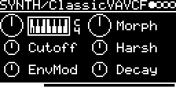

# SYNTH/plaits

Twenty-three engines from Mutable Instruments Plaits ([lib/plaits](../../../lib/plaits)) in one binary: the models
of the original Plaits (its green and red banks: oscillators, noises, physical models and drums) and those Plaits 1.2
added (the orange bank). Two more are in the source, not built by default: 6-OP FM (SYNTH/DxFM_BNK1-3 plays its
patches; see [SYNTH/6-OP-FM](#synth6-op-fm)) and the speech engine (SPEECH/LPC speaks its words; see
[SPEECH/Plaits](#speechplaits)). A switch at the top of `plaits.cpp` builds each: `PLAITS_SIX_OP`, `PLAITS_SPEECH`
0 or 1 (or `-DPLAITS_SIX_OP=1` in a `// build_flags:` line). `app/build.sh` and `sync_readme.sh` take the engine names
as the compiler sees them, so the name comes and goes with it.
The HARMONICS, TIMBRE and MORPH knobs are named after what they do in each model, and Plaits' low-pass gate (LPG) and
decay envelope come with it. The oscillator, noise and physical-model engines are polyphonic over MIDI: four voices,
each with its own Plaits engine, LPG and decay envelope (see [MIDI](#midi)); on Trig and V/OCT one voice plays, as
before. The drums are one voice.

## Engines

| Engine | |
|---|---|
| M-OSC/Virt.Analog | detuned variable square and variable saw |
| M-OSC/Waveshaping | slope oscillator into waveshaper and wavefolder |
| M-OSC/2-OP-FM | two-operator FM with feedback |
| M-OSC/Grain | granular formant oscillator, crossfades into the Z oscillator (AUX) |
| M-OSC/Harmonic | additive, 24 harmonics, crossfades into 8 organ harmonics (AUX) |
| M-OSC/Wavetable | four 8 x 8 wavetable banks, crossfades into a 5-bit version (AUX) |
| M-OSC/Chord | chords from divide-down string-synth oscillators or wavetable waves |
| DRUMS/Analog BD | analog bass drum with overdrive |
| DRUMS/909ish-BD | synthetic bass drum |
| DRUMS/Analog SD | analog snare |
| DRUMS/909ish-SD | synthetic snare |
| DRUMS/Analog HH | hi-hat: six square oscillators, resonant band-pass |
| DRUMS/Analog HH2 | hi-hat: three ring-modulated square pairs |
| M-OSC/Swarm | eight sawtooth (AUX: sine) grains, randomly detuned, from a cloud to a swarm of glissandi |
| NOISE/Filtered | clocked noise through a resonant LP/BP/HP filter (AUX: two band-passes) |
| NOISE/Particle | random impulses into resonant band-passes or an all-pass diffuser (AUX: the raw impulses) |
| SYNTH/String | inharmonic string (Karplus-Strong with dispersion), struck by a noise burst |
| SYNTH/Modal | modal resonator (24 modes), struck by a mallet or noise burst |
| SPEECH/Plaits | vowels from a formant filter, SAM and LPC, then LPC words; only with `PLAITS_SPEECH` 1 |
| SYNTH/ClassicVAVCF | VA oscillator with sub into a resonant 2- or 4-pole low-pass |
| M-OSC/PhaseDist | phase distortion, a synced (AUX: free-running) modulator |
| M-OSC/WaveTerrain | a 2D terrain read along an elliptic path (AUX: path and terrain through a sine) |
| SYNTH/Str.Machine | string machine: a chord of divide-down oscillators, filter and ensemble |
| M-OSC/Chiptune | square-wave chords and arpeggios with a NES triangle bass (AUX) |
| SYNTH/6-OP-FM | six-operator FM (DX7) with the 96 patches of Plaits' three banks; only with `PLAITS_SIX_OP` 1 |

The screenshots show SYNTH/ClassicVAVCF and DRUMS/909ish-BD, the one at the top M-OSC/Virt.Analog.

The first fourteen engines sound as before the others came in (QEMU: the same output bits for Trig/CV, drone, MIDI
notes and chords).

## Parameters

### Common knobs

| Knob | Range | Default | |
|---|---|---|---|
| **V_OCT** | -4 ... +4 octaves | 0 (MIDI 36) | pitch of the Trig/CV voice (not on the drums); transposes the MIDI notes, 0 plays the key |
| **Decay** | 0 ... 1 | 0.5 | LPG and envelope decay of all voices, after a key or gate is let go. With the Trig input set to `-` (and no MIDI note yet) it becomes **Level** and the engine drones. SYNTH/String and SYNTH/Modal have no LPG: there Decay is MORPH, see below |
| **Color** | 0 ... 1 | 0.5 | LPG colour: higher is brighter, toward a plain VCA |
| **AuxMix**, **PD-Mix** | 0 ... 1 | 0.5; 0 on Swarm, Filtered, Particle, SPEECH/Plaits, PhaseDist, WaveTerrain | crossfade from Plaits' OUT to AUX |

Knob layout: M-OSC, NOISE, SPEECH/Plaits, Str.Machine and Chiptune have six knobs (left encoder V_OCT, third knob,
Decay; right encoder second, fourth, last). Drums have four (left: Pitch, Tone; right: second knob, Decay), String
and Modal four too (left V_OCT, Bright; right the second knob, Decay), 6-OP-FM as well (left V_OCT, Bright; right
the patch, Env). ClassicVAVCF: left V_OCT, Cutoff, EnvMod;
right Morph, Harsh, Decay. The knobs act on all voices, sounding notes included.

### M-OSC/Virt.Analog

| Knob | Range | Default | |
|---|---|---|---|
| **Detune** | 0 ... 1 | 0.5 (unison) | saw against square, -24 ... +24 semitones, with plateaus at 0, 7, 12, 19, 24 |
| **Square** | 0 ... 1 | 0.5 | narrow pulse to square at 0.5, above that hard sync |
| **CSAW** | 0 ... 1 | 0.5 | triangle tilting into a saw, then a saw with a widening notch |

### M-OSC/Waveshaping

| Knob | Range | Default | |
|---|---|---|---|
| **Waveform** | 0 ... 1 | 0.8 | waveshaper curve |
| **Fold** | 0 ... 1 | 0.8 | wavefolder amount |
| **Asym** | 0 ... 1 | 0.75 | slope of the source, triangle at 0 |

### M-OSC/2-OP-FM

| Knob | Range | Default | |
|---|---|---|---|
| **Ratio** | 0 ... 1 | 0.8 | modulator frequency, -12 ... +36 semitones, with plateaus |
| **Mod** | 0 ... 1 | 0.8 | modulation index |
| **Feedb.** | 0 ... 1 | 0.75 | below 0.5 feedback into frequency, above into phase, none at 0.5 |

### M-OSC/Grain

| Knob | Range | Default | |
|---|---|---|---|
| **Ratio** | 0 ... 1 | 0.8 | OUT: second formant ±24 semitones. AUX: Z oscillator mode |
| **Frm/Fq.** | 0 ... 1 | 0.8 | formant frequency |
| **Width** | 0 ... 1 | 0.75 | carrier shape |
| **PD-Mix** | 0 ... 1 | 0.5 | OUT (grainlets) into AUX (Z oscillator) |

### M-OSC/Harmonic

| Knob | Range | Default | |
|---|---|---|---|
| **Bump** | 0 ... 1 | 0.8 | number of bumps in the spectrum |
| **Peak** | 0 ... 1 | 0.8 | the most prominent harmonic |
| **Shape** | 0 ... 1 | 0.75 | bump slope, flat and wide at 0, narrow at 1 |
| **AuxMix** | 0 ... 1 | 0.5 | OUT (24 harmonics) into AUX (organ harmonics) |

### M-OSC/Wavetable

| Knob | Range | Default | |
|---|---|---|---|
| **Bank** | 0 ... 0.5 | 0 | up to 0.43 moves through the four banks; above that Row and Column snap more and more to whole waves |
| **Row** | 0 ... 1 | 0.8 | TIMBRE, one axis of the bank |
| **Column** | 0 ... 1 | 0.75 | MORPH, the other axis |
| **AuxMix** | 0 ... 1 | 0.5 | OUT into AUX (5-bit) |

Without user data the fourth bank is a scrambled pick of the built-in waves.

### M-OSC/Chord

| Knob | Range | Default | |
|---|---|---|---|
| **Chord** | OCT, Fifth, min, min7, min9, min11, Maj, Maj7, Maj9, Sus4, 69, 6th, 10th, D7, D7(b9), HD, FD | Maj9 | chord (Jon Butler's table); every MIDI note plays the whole chord |
| **Inv.** | 0 ... 1 | 0.5 | inversion and transposition |
| **Shape** | 0 ... 1 | 0.5 | below about 0.47 string-synth registrations, above about 0.53 wavetable waves |

### DRUMS/Analog BD and DRUMS/909ish-BD

| Knob | Range | Default | |
|---|---|---|---|
| **Pitch** | -1 ... +1 octave | 0 (MIDI 36) | pitch |
| **Drive** (Analog BD) | 0 ... 1 | 0.8 | attack FM, then self FM, overdrive above 0.5 |
| **Punch** (909ish-BD) | 0 ... 1 | 0.8 | FM envelope amount, then its decay |
| **Tone** | 0 ... 1 | 0.5 | tone |
| **Decay** | 0 ... 1 | 0.5 | decay |

### DRUMS/Analog SD and DRUMS/909ish-SD

| Knob | Range | Default | |
|---|---|---|---|
| **Pitch** | -1 ... +1 octave | 0 (MIDI 60) | pitch |
| **Snappy** | 0 ... 1 | 0.5 | snare noise level |
| **Tone** | 0 ... 1 | 0.5 | Analog SD: tone. 909ish-SD: FM amount |
| **Decay** | 0 ... 1 | 0.5 | decay |

### DRUMS/Analog HH and DRUMS/Analog HH2

| Knob | Range | Default | |
|---|---|---|---|
| **Pitch** | -1 ... +1 octave | 0 (MIDI 60) | pitch of the metallic noise |
| **Noise** | 0 ... 1 | 0.5 | blend toward clocked random noise |
| **Tone** | 0 ... 1 | 0.9 | band-pass/high-pass frequency, 150 Hz ... 16 kHz |
| **Decay** | 0 ... 1 | 0.6 | decay |

### SYNTH/ClassicVAVCF

| Knob | Range | Default | |
|---|---|---|---|
| **Morph** | 0 ... 1 | 0.5 | saw, square at 0.5, narrowing pulse, back to square. Sub octave fades in at both ends |
| **Cutoff** | 0 ... 1 | 0.5 | cutoff, tracks the note: 2 octaves below at 0, up to 8 above (max 12 kHz) |
| **Harsh** | 0 ... 1 | 0.5 | 4-pole on the left, 2-pole on the right, no resonance in the middle, more drive toward 1 |
| **EnvMod** | -1 ... +1 | 0 | envelope depth on the cutoff, up or down |
| **Decay** | 0 ... 0.99 | 0.5 | see above |

### M-OSC/Swarm

| Knob | Range | Default | |
|---|---|---|---|
| **Spread** | 0 ... 1 | 0.5 | how far the eight grains are detuned at random: none at 0, ±6 semitones at 0.5, ±4 octaves at 1 |
| **Density** | 0 ... 1 | 0.5 | how often new grains start |
| **Overlap** | 0 ... 1 | 0.5 | grain length: short grains toward 0; above about 0.71 they glide into each other (a swarm of glissandi) |
| **AuxMix** | 0 ... 1 | 0 | OUT (saws) into AUX (sines) |

A Trig starts a burst of grains that slows down; with the Trig input set to `-` the grains go on without end.

### NOISE/Filtered

| Knob | Range | Default | |
|---|---|---|---|
| **Filter** | 0 ... 1 | 0.5 | OUT: low-pass, band-pass at 0.5, high-pass. AUX: the second of two band-passes, -24 ... +24 semitones from the first |
| **Clock** | 0 ... 1 | 0.9 | clock of the noise (sample and hold), about 2 Hz ... 13 kHz (from 8 Hz in the drone); 0.9 is 5.5 kHz |
| **Reson.** | 0 ... 1 | 0.5 | resonance, Q 0.5 ... 512 (16 at 0.5) |
| **AuxMix** | 0 ... 1 | 0 | OUT into AUX |

The filters sit at the note (V_OCT, V/OCT, MIDI key). A Trig restarts the noise clock.

### NOISE/Particle

| Knob | Range | Default | |
|---|---|---|---|
| **Spread** | 0 ... 1 | 0.5 | each impulse's band-pass is put at random around the note, up to ±48 semitones at 1 (±12 at 0.5) |
| **Density** | 0 ... 1 | 0.65 | impulses: about one a second at 0, 50 at 0.65, 6000 at 1 |
| **Filter** | 0 ... 1 | 0.7 | below 0.5 an all-pass diffuser, more of it toward 0 (a smear like a reverb); above 0.5 the band-passes resonate more and more |
| **AuxMix** | 0 ... 1 | 0 | OUT into AUX (the raw impulses) |

A Trig fires an impulse at once. OUT is 3 times as loud as in Plaits and without its limiter, which held the spiky
impulses 10 dB below the oscillators; the soft limit of the output (see [MIDI](#midi)) rounds off their peaks.

### SYNTH/String and SYNTH/Modal

| Knob | Range | Default | |
|---|---|---|---|
| **Inharm.** (String) | 0 ... 1 | 0.5 | below 0.24 a curved bridge that buzzes (sitar), up to 0.26 a plain string, above it a stiffer and stiffer, inharmonic string |
| **Struct.** (Modal) | 0 ... 1 | 0.5 | the ratios of the modes: from harmonic to bell-like and inharmonic (the material) |
| **Bright** | 0 ... 1 | 0.5 | brightness of the strike (noise burst or mallet); in the drone also how dense the dust that excites it |
| **Decay** | 0 ... 1 | 0.5 | MORPH: the damping, short at 0, long at 1 |

Both ring by themselves, as in Plaits: no LPG, no sustain, the Note Off lets them ring on. A Trig strikes; with the
Trig input set to `-` they are excited all the time by dust (Level 0.5). On Trig and V/OCT the string engine rings three
strings in turn, so a note rings on under the next (Plaits); each MIDI voice is one string. The string goes into
Plaits' limiter with a gain of 5 instead of 1, else it is 14 dB below the oscillators.

### SPEECH/Plaits

Not built by default (SPEECH/LPC has its words): `PLAITS_SPEECH` 1 adds it, 21 KB more code.

| Knob | Range | Default | |
|---|---|---|---|
| **Model** | 0 ... 1 | 0.5 | up to 1/6 formant-filter vowels into SAM's, up to 1/3 into LPC vowels, up to 0.43 LPC phonemes; then the five word banks of SPEECH/LPC: colours (from 0.43), numbers (0.54), letters (0.64), NATO alphabet (0.74), synth words (0.84) |
| **Species** | 0 ... 1 | 0.5 | formant shift, from a giant to a chipmunk; with the words outside 0.4 ... 0.6 also faster or slower |
| **Phon.** | 0 ... 1 | 0.5 | the vowel or phoneme; with the words, the word |
| **AuxMix** | 0 ... 1 | 0 | OUT into AUX (the raw excitation, buzz and noise before the vocal tract) |

A Trig speaks the word with its own intonation and envelope (no LPG); in the vowel models it opens the LPG, in the LPC
phonemes with a consonant first. In Trig mode the engine is silent until the first Trig. One voice: on the track's MIDI
channel the firmware plays the notes as Trig and V/OCT, as on the drums. Loading a word bank (at the first Trig, or
when Model moves to another bank) takes up to 60k instructions in that frame (20 % in QEMU), as in Plaits.

### M-OSC/PhaseDist

| Knob | Range | Default | |
|---|---|---|---|
| **Ratio** | 0 ... 1 | 0.5 | frequency of the modulator, as Ratio of 2-OP-FM |
| **Amount** | 0 ... 1 | 0.5 | how far the phase is distorted (less on high notes) |
| **Asym** | 0 ... 1 | 0.5 | asymmetry: pulse width of the distortion, 50 ... 99 % |
| **AuxMix** | 0 ... 1 | 0 | OUT (the modulator synced to the note) into AUX (free-running: phase modulation) |

### M-OSC/WaveTerrain

| Knob | Range | Default | |
|---|---|---|---|
| **Terrain** | 0 ... 1 | 0.5 | eight terrains, crossfaded: five functions of sines and fractions, then three built from wavetables |
| **Radius** | 0 ... 1 | 0.5 | radius of the path, 0.1 ... 1 (smaller on high notes) |
| **Offset** | 0 ... 1 | 0.5 | where the path lies on the terrain, -1 ... +0.9 |
| **AuxMix** | 0 ... 1 | 0 | OUT (the terrain along the path) into AUX (the path's y plus the terrain through a sine) |

### SYNTH/Str.Machine

| Knob | Range | Default | |
|---|---|---|---|
| **Chord** | as M-OSC/Chord | Maj9 | chord; every MIDI note plays the whole chord |
| **Filter** | 0 ... 1 | 0.5 | low-pass cutoff, opens toward 1; and the ensemble (chorus): none at 0.5, more toward both ends |
| **Regist.** | 0 ... 1 | 0.5 | registration: eleven mixes of saw and square footages, from saw to square |
| **AuxMix** | 0 ... 1 | 0.5 | OUT and AUX are Plaits' stereo pair (left, right): 0.5 is the mono sum |

### M-OSC/Chiptune

| Knob | Range | Default | |
|---|---|---|---|
| **Chord** | as M-OSC/Chord | Maj9 | chord |
| **Arp** / **Inv.** | 0 ... 1 | 0.5 | Trig patched: the arpeggio of the Trig/CV voice, 12 patterns (up, down, up-down, random; each over 1, 2 or 4 octaves). Without Trig and on the MIDI voices the chord's inversion and transposition (**Inv.**) |
| **Shape** | 0 ... 1 | 0.5 | pulse width, then sync |
| **Decay** | 0 ... 1 | 0.5 | Trig/CV voice: each Trig plays the next note of the arpeggio, Decay is how long it sounds, with the bass (1: it holds until the next Trig, Plaits without envelope). MIDI voices and drone: as above |
| **AuxMix** | 0 ... 1 | 0.5 | OUT (the squares) into AUX (NES triangle bass an octave below the root) |

The Trig/CV voice is Plaits' chiptune with the Trig as the arpeggiator's clock, with its own envelope and no LPG. The
MIDI voices play the chord through the LPG (as a VCA: no filtering) and hold while the key is down.

### SYNTH/6-OP-FM

| Knob | Range | Default | |
|---|---|---|---|
| *patch name* | 0 ... 95 | 0 (SOLID BASS) | the patch: Plaits' three banks of 32 DX7 voices one after the other (the 96 of SYNTH/DxFM_BNK1-3) |
| **Bright** | 0 ... 1 | 0.5 | TIMBRE: the level of the modulators, the patch's at 0.5 |
| **Env** | 0 ... 1 | 0.5 | MORPH: attack and decay faster to the left, slower to the right (the patch's at 0.5); the release is the patch's at 0.3 and gets slower away from it. With the Trig input set to `-`: the point in time at which the envelopes stand still (0 ... 1.5 s), Plaits' "time travel" |

Plaits' 6-OP engine (`lib/plaits/dsp/fm`), not msfa as SYNTH/DxFM: two FM voices in turn per voice, so the release of
a note rings on under the next. It has its DX envelopes and no LPG: they hold while the key (or the gate after a Trig)
is held and go to their release with the Note Off, as on the DX7; a shorter note holds them for 2 ms. Velocity goes
to the operators by their velocity sensitivity, as on the DX7 (74 of the 96 patches have one; a Trig is 0.8). The
level is Plaits', it varies with the patch: -6 ... -17 LUFS on Trig (Virt.Analog -9). With the Trig input set to `-`
the drone is the first voice with the envelopes standing still (quiet for many patches). The patch names are cut
after nine letters on the display, as in SYNTH/DxFM. Not built by default: `PLAITS_SIX_OP` 1 adds it, 30 KB more
code (tested on the DSM: four voices 46k cycles, 19 % of a frame).

## MIDI

The oscillator, noise and physical-model engines (M-OSC/..., NOISE/..., SYNTH/...) are MIDI engines: with a MIDI
channel on the track (or the MIDI out of another track, `$1MIDI`..`$4MIDI` on its I/O page) the notes play four voices
of their own, next to the Trig/CV voice. Trig and V/OCT keep working as before. The drums and SPEECH/Plaits take MIDI
as before (Trig, V/OCT).

- A Note On pings the voice's LPG and starts its envelope, as a Trig does. The LPG stays open while the key is held
  (sustain); the Note Off lets the note die away with Decay. A note shorter than the LPG's rise (a few ms, longer
  for low notes) is a plain ping as before. CC 64 (sustain pedal) holds the released keys until the pedal goes up.
- SYNTH/String and SYNTH/Modal have no LPG: a Note On strikes, and the note rings by itself with Decay; Note Off and
  pedal change nothing. M-OSC/Chiptune's MIDI voices play the chord (Inv.), not the arpeggio. SYNTH/6-OP-FM holds its
  DX envelopes while the key or the pedal is down, its Note Off is the DX release.
- Velocity sets the voice's level (linear, 127 = the level of a Trig); on SYNTH/6-OP-FM it goes to the operators, as
  on the DX7.
- The pitch is the key plus the V_OCT knob plus pitch bend (+-12 semitones, like the firmware's bend on V/OCT). The
  V/OCT input, the quantizer and TRANSPOSE/FINE of the I/O page act on the Trig/CV voice only.
- More than four keys: the new one takes the voice released longest ago, else the one held longest. A key played
  again retriggers its own voice.
- A MIDI voice sounds in the frame of its Note On. A Trig reaches the Trig/CV voice 4 ms later (Plaits' trigger delay
  line, see [Notes](#notes)).
- The firmware also makes a Trig of each note on the track's MIDI channel; the engine skips it, so a note does not also
  play the Trig/CV voice. A Trig at the input in the same 0.5 ms frame as a Note On is lost with it.
- With the Trig input set to `-`, the drone stops at the first MIDI note and stays off until the engine is loaded
  again; the knob is Decay from then on.
- Two tracks with an oscillator engine on the same channel both play every note (before, the firmware shared the
  notes out to them as voices).
- CC 120/123 (All Sound/Notes Off) and MIDI Stop let go of all keys (the pedal too); what sounds dies away
  with Decay.
- A chord sums its notes. While MIDI voices sound, the output is rounded off softly above 0.85 and reaches 1.0 at
  1.3, as in SYNTH/DxFM: single notes stay as they are, loud chords saturate a little instead of clipping hard.
  Lower the track level if that is too much. The Trig/CV voice alone of the first fourteen engines is never limited;
  that of the others always (Plaits' own limiter lets the attack of a Trig through, in Modal up to 1.35).

## Inputs and outputs

- Trig: pings the LPG and starts the envelope of the Trig/CV voice, or strikes the drum. The LPG of an oscillator
  stays open while the gate stays high after the Trig and dies away with Decay when it falls (the drums are struck
  only). With the Trig input set to
  `-`, oscillators play at the Level set by the Decay knob and the drums sound continuously (Plaits' unpatched mode);
  an oscillator engine until its first MIDI note. With the Trig input patched, the Trig/CV voice is silent until its
  first Trig (the chiptune's bass and the speech engine's scan sound without the LPG).
- V/OCT on every engine; the Trig/CV voice follows it while it sounds. The drums have no V_OCT knob, so no -2 octave
  bias: Pitch and V/OCT add to MIDI 36 (BD) or 60 (SD, HH).
- Output is mono on both channels.

## Notes

- Runs at 48 kHz in 24-sample blocks. Plaits computes its envelope and LPG steps for 12-sample blocks, here they
  advance once per 24 samples. `Voice::Render()` reads its trigger delay line at delay 0 after writing, which is
  the slot written 8 frames before: a Trig reaches the LPG 4 ms later. The MIDI voices put their trigger into the
  slot read in the same frame.
- An oscillator voice is computed from its trigger until it is let go and its output has stayed below -84 dB for
  8 ms (at Decay 0.5 about 4.5 s after the note); an idle voice costs nothing. A drum is computed all the time, as
  before.
- CPU in QEMU (600 MHz): Trig/CV only 2.4-3.7 % (+0.1 % against the mono engine), four sounding MIDI voices
  9-15 %, up to 17 % in a frame (Harmonic, Chord and Wavetable the most). The engines added later: Trig/CV only
  1.4-4.4 %, four voices 7 % (String) ... 17 % (Particle, Str.Machine); SPEECH/Plaits 1 %, 20 % in the frame it loads a
  word bank. SYNTH/6-OP-FM: Trig/CV 2.7-3.5 %, four voices 11 %, up to 14 %.
- On the DSM (480 MHz, 2026-10-18): one sounding voice 16-22k cycles, about what the mono engine took, each further
  voice 12-18k; nothing sounding 2.6-2.9k (the mono engine always ~18k). Four voices: 50k (Waveshaping) ... 75k
  cycles (ClassicVAVCF), 21-31 % of a frame, no underruns. The drums ~17k as before (+1k for the mixing). The engines
  added later, four voices: 32k (String) ... 84k cycles (Particle, 35 %), no underruns.
- Each voice has its engine on the heap (a drum one): 4-8 KB with the module RAM. The engines added later:
  NOISE/Particle 81 KB (its diffuser, 16 KB a voice), SYNTH/String 36 KB (the Trig/CV voice's three strings 15 KB, a
  MIDI voice's string 5 KB), SYNTH/6-OP-FM 40 KB (the 96 patches unpacked once, 15 KB, and 4.3 KB a voice),
  SYNTH/Str.Machine 23 KB (its ensemble), SPEECH/Plaits 15 KB (the LPC word bank), the others 1-3 KB. If an
  allocation fails it shows "OUT OF MEMORY", and the voices from there on stay silent.

Code 166 KB (with SYNTH/6-OP-FM 30 KB more, with SPEECH/Plaits 21 KB more), RAM 3.5 KB.

## License and credits

- `plaits.cpp`: © 2022 E.Heidt, MIT license (see [License](../../../README.md#license)).
- [lib/plaits](../../../lib/plaits): Mutable Instruments Plaits, © Emilie Gillet, MIT license.
