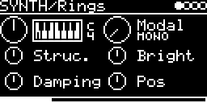

# SYNTH/Rings

Mutable Instruments Rings: modal resonator, sympathetic strings, a modelled string and a small FM voice, each with
one, two or four voices. A trigger strikes it with Rings' internal exciter. Audio from the I/O page (another track
or an input jack) excites it too, so it also works as a resonator for other sounds. Patches of SYNTH/Resonator, its name
until 2026-10-26, load it with V_OCT 2 octaves down: the firmware played V_OCT 2 octaves lower until 2026-10, so they
sound as they did.

## Parameters

| Knob | Range | Default | |
|---|---|---|---|
| **V_OCT** | -4 ... +4 octaves | 0 (C4) | pitch and tonic, Rings' FREQUENCY (see Notes) |
| **Model** | 15 entries, see below | Modal mono | model and polyphony |
| **Struc.** | 0 ... 1 | 0.5 | STRUCTURE, depends on the model |
| **Bright** | 0 ... 1 | 0.5 | BRIGHTNESS |
| **Damping** | 0 ... 1 | 0.5 | DAMPING, the decay time |
| **Pos** | 0 ... 1 | 0.5 | POSITION, where the resonator is excited |

Left encoder: V_OCT, Struc., Damping. Right encoder: Model, Bright, Pos.

### Models

Five models, each as mono, duo and quadro (1, 2 or 4 voices), mono ones first.

| Model | | Struc. | Pos |
|---|---|---|---|
| Modal | modal resonator, 60 modes (mono), 28 (duo), 12 (quadro) | spacing of the modes (inharmonicity) | excitation point |
| Sympath. | sympathetic strings, 8 (mono), 4 (duo), 2 (quadro) | tuning of the other strings | excitation point |
| String | one string with dispersion | dispersion, none around 0.25 | excitation point |
| FM | two-operator FM voice | frequency ratio (quantized) | feedback |
| StrQuant. | sympathetic strings tuned to a chord | the chord: OCT, 5, sus4, m, m7, m9, m11, 6/9, M9, M7, M | excitation point |

## Inputs and outputs

- Trig: strikes the resonator. Triggers within 10 ms of the last one are ignored.
- Audio input (left channel only): set AUX-INPUT (jack or `USB`, level with AUX-LEVEL) or #&lt;track&gt; &lt;engine&gt;
  on the I/O page. It continuously excites the voice that was struck last.
- As on Rings with IN patched, the audio input then is the exciter: a trigger moves to the next voice and its note
  but strikes no internal exciter, Bright is the input's low-pass (about 4 kHz at 0.5, not relative to the note),
  and without TRIG-INPUT the onsets of the audio strike too (besides MIDI notes). There are no jacks to look at: the
  input counts as patched while audio above -50 dBFS RMS comes in and for 100 ms after it; a trigger in a silence
  strikes the internal exciter as before.
- Stereo out. With one voice: Rings' ODD and EVEN outputs (for Modal the odd and even modes). With more voices they
  alternate between left and right.

Each trigger moves to the next voice; the previous one keeps its note and rings out.

## Notes

- As on Rings, the pitch is a tonic and a note. The tonic is Rings' FREQUENCY knob, here the V_OCT knob (0: C4,
  the 0 V note); the note is the V/OCT input, MIDI and the transpose of the I/O page. Each voice keeps its note while
  it rings out; the tonic is shared: turning V_OCT retunes all voices, and Sympath. tunes a string (two, with the
  detuned one) to it, near Struc. 0. While V_OCT is modulated, the tonic stays at C2, so that a modulation (RND, TM)
  does not retune the voices ringing out.
- StrQuant.: Struc. picks one of the 11 chords, with Rings' hysteresis between them.
- Struc. ends at 0.9995 inside, as on Rings.
- Runs at Rings' own rate and block size (48 kHz, 24 samples), output through Rings' limiter.
- Most of the RAM is the eight strings' delay lines (98 KB), taken from the heap at setup for all models.

Code 46 KB, RAM 12 KB + 98 KB heap.

## License and credits

- `rings.cpp`: © E.Heidt, MIT license (see [License](../../../README.md#license)).
- [lib/rings](../../../lib/rings): Mutable Instruments Rings, © Emilie Gillet, MIT license.
