# □︎●︎ Quick start

This page gets you from "just flashed" to a small patch with drums, a synth voice, a sequencer, an effect and a
modulation in about 15 minutes. The [README](README.md) has the full reference for every page.

> The pictures and jack names are those of the O_C T4.0 (`T1` … `T4`, `C1` … `C4`, `A` … `D`). The DSM0 has the
> same buttons, encoders and pages, but its I/O page names the jacks differently: inputs `1` … `8` (track *n* listens
> to input *n* for triggers and to input *n*+4 for V/OCT), outputs `C` and `D` (all tracks play on `C+D` by default).
> Its display has no output circles at the top right. Where this page says `T2` or `C2`, pick the matching jack of
> your module on the I/O page.

## 1. The idea

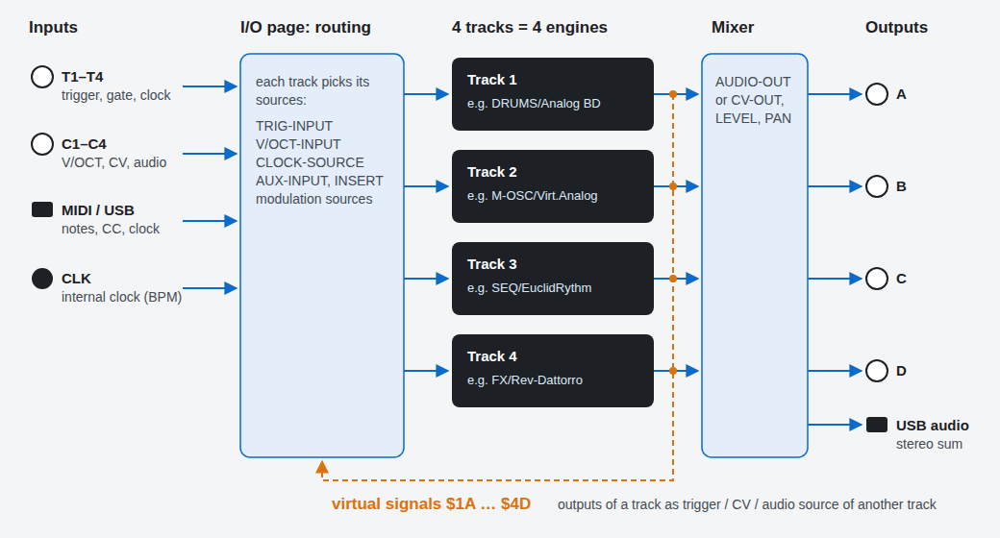

* The module has **4 tracks**. Each track runs **one engine**: a drum, an oscillator, a synth, an effect, a
  sequencer, a CV tool, ... The engines are grouped in *machines* (`DRUMS`, `M-OSC`, `SYNTH`, `FX`, `SEQ`, `CV`, ...),
  see the [engine list](README.md#engines).
* On the **I/O page** every track picks its sources (trigger, V/OCT, clock, audio input) and its output.
  Nothing is hard-wired: any track can listen to any jack.
* The CV outputs of a track (not the audio) are also available inside the module as **virtual signals** `$1A` …
  `$4D` (`$3A` = first output of track 3). With them a sequencer on one track can trigger a drum on another track
  without a cable.
* Several tracks can share one output - they are mixed.

When you load an engine on the O_C T4.0, the track gets this default routing:

| Track | Trigger / gate | V/OCT, accent | Output |
|:-----:|:--------------:|:-------------:|:------:|
| 1     | `T1`           | `C1`          | `A`    |
| 2     | `T2`           | `C2`          | `B`    |
| 3     | `T3`           | `C3`          | `C`    |
| 4     | `T4`           | `C4`          | `D`    |

## 2. The controls

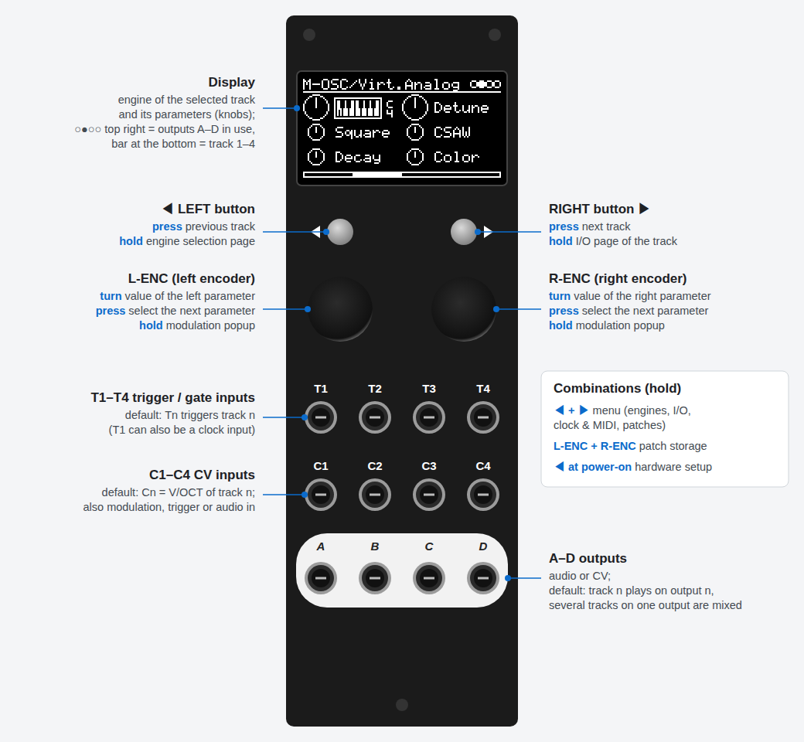

* **Press** means a short click, **hold** means keep it pressed for a moment.
* On the track page each encoder controls the parameter whose knob is drawn **big**: turn to change the value,
  press to move on to the next parameter on that side. Engines with many parameters show a list instead
  (L-ENC selects, R-ENC changes), some engines (e.g. the sequencers) draw their own page.
* The circles at the top right show the outputs (`A` … `D`) the track plays on, the bar at the bottom shows which of
  the 4 tracks you are looking at.

## 3. The pages

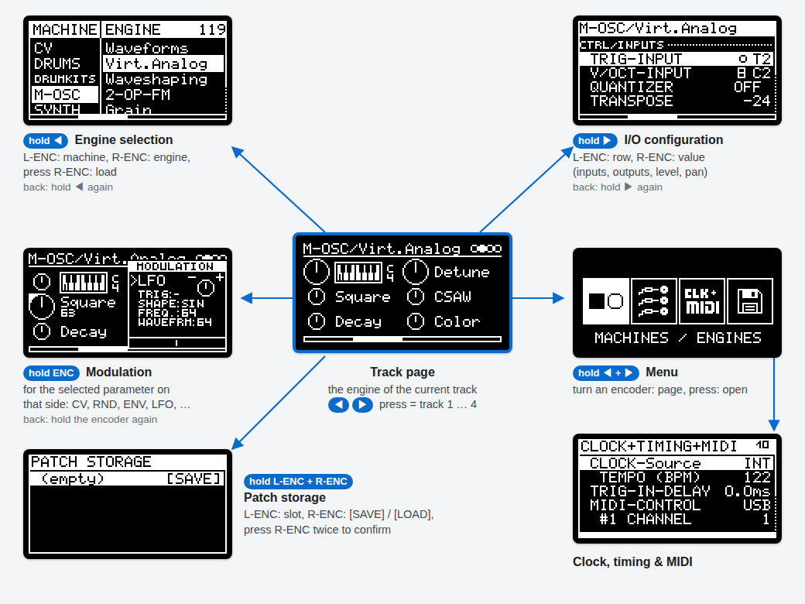

Everything starts at the **track page**. Holding the same control again (or holding **◀ + ▶**) brings you back to it.
**◀ / ▶** switch between the tracks on the I/O page as well.

## 4. Your first patch

### Step 1 - a kick drum on track 1

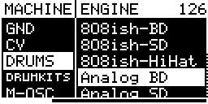

1. **Hold ◀** - the engine selection page opens.
2. Turn **L-ENC** to the machine `DRUMS`, turn **R-ENC** to the engine `Analog BD`.
3. **Press R-ENC** - the engine is loaded and you are back on the track page.

 

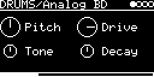

4. Patch a trigger or gate (a clock, a sequencer, ...) into **T1** and **output A** into your mixer.
5. Turn the encoders: `Pitch`, `Tone`, `Drive`, `Decay`. Press an encoder to pick another parameter on its side.

 

### Step 2 - a synth voice on track 2

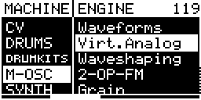

1. **Press ▶** - track 2 (the bar at the bottom moves).
2. **Hold ◀**, choose `M-OSC` / `Virt.Analog`, **press R-ENC**.
3. Patch a pitch CV (1 V/oct) into **C2**, a gate into **T2**, and **output B** into your mixer.

 

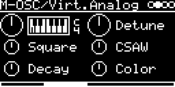

The top-left knob with the little keyboard is the pitch: the encoder sets the base note, the CV at `C2` is added.
`Decay` is the length of the envelope that `T2` triggers.

 

### Step 3 - change the routing on the I/O page

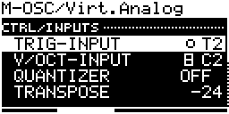

**Hold ▶** on track 2. The I/O page lists the inputs (`CTRL/INPUTS`) and outputs (`MIX/OUTPUTS`) of the engine:

* **L-ENC** selects a row, **R-ENC** changes its value.
* `TRIG-INPUT`, `V/OCT-INPUT` - where trigger and pitch come from.
* `QUANTIZER` / `ROOT` - quantize the pitch to a scale, `TRANSPOSE` / `FINE` - shift it.
* `AUDIO-OUT` - `A` … `D`, `A+B` / `C+D` for stereo, or `-` for no output; `PAN` and `LEVEL` below it.

The small dot in front of a trigger input flashes on every trigger, the small box in front of `V/OCT-INPUT` shows the
voltage - handy for checking your cables. **Hold ▶** again to go back.

 

### Step 4 - a sequencer without cables

1. **Hold ◀ + ▶** - the menu opens. Turn an encoder to `CLK & MIDI SETTINGS` and press it.
   Set `CLOCK-Source` to `INT` and the `TEMPO (BPM)` you like (see [step 7](#step-7---clock-and-midi)).
2. Go to track 3 (**▶**), load `SEQ` / `EuclidRythm`. It runs on the clock and plays a euclidean rhythm.

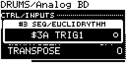

3. Go to track 1 (**◀ ◀**), **hold ▶** for its I/O page, select `TRIG-INPUT` and turn R-ENC past `T1` … `C4`
   to `$3A`. The box shows what is behind the virtual signal: `#3 SEQ/EuclidRythm`, `$3A TRIG1`.

The kick now plays the euclidean rhythm of track 3 - no patch cable needed. (EuclidRythm also sends its triggers to
output `C` - set its `TRIG1-OUT` to `-` on its I/O page if you need the jack for something else.)

 

### Step 5 - an effect

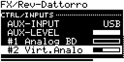

Effects (`FX`, `FILTER`, ...) are engines with an audio input:

1. Go to track 4, load `FX` / `Rev-Dattorro`.
2. **Hold ▶**: turn up `#2 Virt.Analo` - the level at which track 2 (its number and engine) is fed into the reverb.
   `AUX-INPUT` would take an external signal from a `C` input instead.
3. Go to track 2's I/O page and set its `AUDIO-OUT` to `-` - you now hear track 2 only through the reverb
   (on output `D`; `D/W` on the reverb's track page sets the dry/wet mix).

 

### Step 6 - modulation

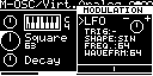

Every parameter can be modulated:

1. On track 2, select `Square` with **L-ENC** (press it until the `Square` knob is big).
2. **Hold L-ENC** - the modulation popup opens on the other side.
3. Use the encoder on the popup's side: turn it to choose the type (`CV`, `RND`, `ENV`, `LFO`, `EF`, `TM`, `SEQ`),
   press it to step through the rows (for the `LFO`: `TRIG`, `SHAPE`, `FREQ.`, `WAVEFRM`) and the amount knob at
   the top right (`-` … `+`).
4. **Hold L-ENC** again to close the popup - the modulation keeps running.

With the type `CV` a parameter follows a `C` input (or a virtual signal), so all 4 CV inputs can modulate anything.

 

### Step 7 - clock and MIDI

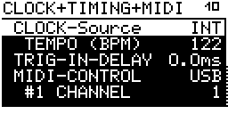

**Hold ◀ + ▶**, turn to `CLK & MIDI SETTINGS`, press.

* `CLOCK-Source`: `-`, `INT` (with `TEMPO (BPM)`), `T1` (4 ppqn) or `MIDI`. Sequencers, clocked delays and the
  modulation sources with `CLK` follow it.
* `TRIG-IN-DELAY`: delays the trigger inputs, e.g. to line them up with MIDI.
* `MIDI-CONTROL` and `#1 CHANNEL` … `#4 CHANNEL`: play the tracks from USB MIDI (or the MIDI input) - note on/off
  becomes trigger, gate and pitch; CC 16 … 23 set the parameters. Tracks on the same channel play polyphonically.

 

### Step 8 - save the patch

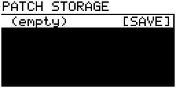

**Changes are not saved automatically.** **Hold L-ENC + R-ENC** for the patch storage page:

* **L-ENC** selects the slot (`(empty)` adds a new one), **R-ENC** chooses `[SAVE]` or `[LOAD]`.
* **Press R-ENC**, a box asks `SAVE?` / `LOAD?` - **press R-ENC** again to confirm.

The patch you saved or loaded last comes back at the next power-on.

 

## 5. Cheat sheet

| Where | Control | Does |
|---|---|---|
| track page | press ◀ / ▶ | previous / next track |
| track page | turn L-ENC / R-ENC | change the parameter with the big knob |
| track page | press L-ENC / R-ENC | next parameter on that side |
| track page | hold L-ENC / R-ENC | modulation popup for that parameter |
| track page | hold ◀ | engine selection page (hold again: back) |
| track page | hold ▶ | I/O page of the track (hold again: back) |
| I/O page | press ◀ / ▶ | I/O page of the previous / next track |
| track page | hold ◀ + ▶ | menu (engines, I/O, clock & MIDI, patches) |
| other pages | hold ◀ + ▶ | back to the track page |
| track page | hold L-ENC + R-ENC | patch storage |
| engine page | hold R-ENC | load with options: reset or keep the I/O settings, or copy track 1-4 |
| power-on | hold ◀ | hardware setup: display, encoders, calibration, I/O test |
| power-on | hold ▶ | start without restoring the patch |

## 6. Good to know

* **First start on a new module:** run the [hardware setup](README.md#hardware-setup-procedure) once - display
  orientation, encoder direction and the DAC/ADC calibration (you need a multimeter for the outputs).
* **Firmware and engines** are installed with the [web flasher](https://eh2k.github.io/□●/flash/?firmware) in Chrome
  or Edge (WebUSB).
* **USB:** the module is a class-compliant USB MIDI device and a USB sound card (the stereo sum of all tracks goes to
  the computer; the computer's playback arrives at `AUX-INPUT` `USB` of effect engines).
* **Screensaver:** after a while without touching the module the display shows a screensaver - any control brings
  the page back.
* **More:** every engine has its own page with all parameters - follow the links in the
  [engine list](README.md#engines). The modulation types and all I/O options are described in the
  [README](README.md#modulations).
